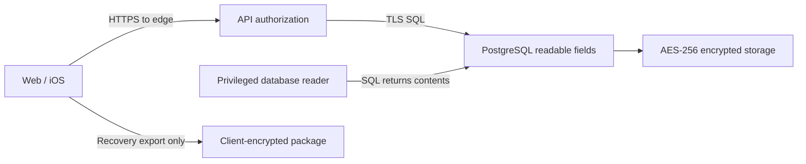
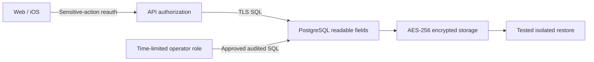
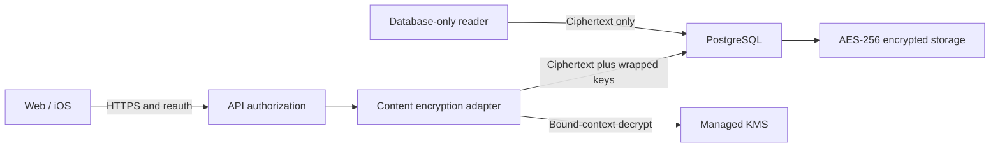
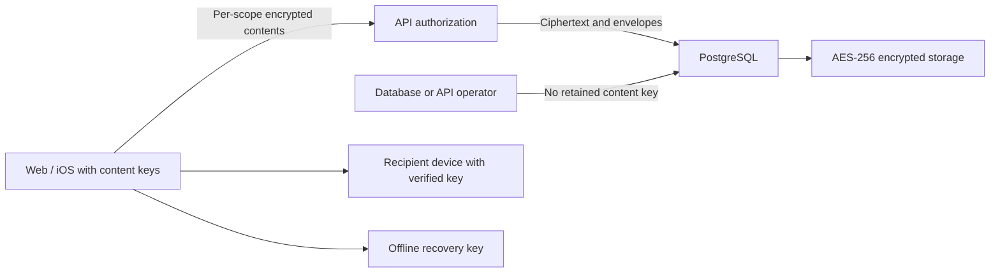

# Security Hardening Proposal: 私有内容与密钥边界

## Decision

Status: HISTORICAL DESIGN COMPARISON; Option2 selected2026-09-22 and implemented in staging. Current execution:[implementation](../implementation/envelope.md),[handoff](../../handoff.md). Original review date:2026-09-21. 本文回答“如何做到可信的信息保护”，不宣称发现了可利用入侵或完成了独立审计。我们在当前架构上选择加固边界，尚未改变运行数据、密钥或产品承诺。

## Executive Recommendation

我们有三个实际不同的选择：选项1保留数据库透明加密并完成生产保护；选项2在此基础上增加应用层信封加密；选项3把在线内容加密及密钥持有移到客户端。我推荐选项2适配首发的小团队、自助恢复和既有逐人共享；如果“运营者也无法解密在线内容”成为硬要求，选项3才对应那个承诺。

这不是把三种方案分别售给不同套餐。Free和Family应共享同一最低保护标准，付费购买持续服务，不能购买免于基础风险的资格。

## Evidence

我直接检查了下列边界。代码与当天前一阶段的运行回读分开记录，未读取真实用户Matter内容。证据文件哈希在[context](../context.md)中，源码路径从仓库根解析；证据编号在这里同时配有名称。

| Evidence | Finding or document | What it establishes |
| --- | --- | --- |
| E01 | Staging加密／网络／角色，infra/aws/lib/rillora-staging-stack.ts | 代码启用RDS存储加密、私网数据库、verify-full；Gateway的CloudMap集成未配置TLS |
| E02 | Matter读写，apps/api/src/routes.ts:303、355 | title/location/details/notes以文本或JSON参数写入，合法SQL读取返回业务明文 |
| E03 | 数据库连接，apps/api/src/db.ts:9、42 | TLS证书校验、事务内角色分离，不是内容密钥隔离 |
| E06 | Matter表及RLS，apps/api/migrations/0001_initial.sql:120、345 | 强制租户RLS存在；列本身是text等业务表示 |
| E07 | 付费截止副本，apps/api/migrations/0052_paid_snapshot_capture_boundaries.sql:2 | 共享副本保存已授权JSON字段，迁移不能漏掉这条副本路径 |
| E08 | 浏览器草稿，apps/web/src/matterDraftStorage.js:1 | 草稿作为JSON写sessionStorage，24小时边界不等于内容加密 |
| E09 | 恢复包，apps/web/src/startHereCrypto.js:24 | 该路径有AES-256-GCM／HPKE客户端加密，不能推广成全在线Matter的性质 |
| E10 | 会话Keychain，apps/ios/Rillora/Core/Authentication/SessionTokenStore.swift:22 | token使用ThisDeviceOnly；代码未提供每次读取的biometry访问条件 |
| E11 | 当天既有AWS回读 | 实际RDS加密开启，但仍是SingleAZ、1日备份的staging，不是生产恢复证明 |

Observed：以上是源码或标注日期的回读。Inferred：数据库逻辑导出和特权查询仍可包含普通在线内容，因此仅凭RDS加密不能承诺数据库读取权与内容访问权分离。没有利用测试证明账户被攻破，不能把设计缺口包装成已发生泄露。

## Current Design And Failure Mode

当前系统把授权放在API和数据库RLS中，这对A、B、C之间的隔离有实际作用。RDS则保护底层磁盘、快照等存储介质。我们要补的边界是：得到业务数据库逻辑读取权的人，不应仅靠一次SELECT或逻辑导出便得到私人说明。

当前代码允许受信任运行时读取明文以完成逐级共享、编辑合并、导出和付费截止副本。这是架构事实，不是AES被破解。若我们只改主Matter表，却保留共享副本、维护更正历史或日志中的完整正文，新增加密就不能达到目标。标题、平台、地址、位置等同样可能揭示资产关系，不能只保护Notes而宣称整张地图加密。

## Desired Invariants

- 正文及所有保留副本的机密等级一致；新写入不得悄悄退回明文。
- 数据密钥与正文不以明文保存在同一数据库或环境变量中。
- 解密前使用服务器验证的身份、owner和当前共享范围；不信任客户端提交的owner、keyId或scope。
- B只能取得获准字段；撤销及Never disclose立即阻止未来服务器读取，不承诺召回已下载资料。
- 错误密钥／错误AAD／篡改密文必须失败；不能以“尽量显示数据”为由回退。
- 恢复演练包含密钥可用性、权限撤销和删除重放，而不只是数据库能启动。

## Constraints And Non-Goals

我们保留Web与iOS核心API、Free1/Family5、年付88.80、原有UI和用户对恢复的期待。不增加密码、助记词、身份证附件或自动身后释放，不部署自建HSM集群。本轮未承诺实施天数或外审价格。

所有选项都需要生产隔离、内部传输保护的逐跳核验、抗钓鱼登录优先、敏感操作重新认证、可靠恢复通知、最少管理员访问、日志脱敏和备份恢复。Auth0 CLI缺少read:mfa_policies，本次没有扩大scope或重做本人登录；不能把“支持Passkey”说成“所有账户已强制MFA”。

## Before Architecture

当前简图只表达内容边界。它省略了网关内部跳，不能据图声称所有内部传输都已经TLS化。

我们目前的内容访问边界止于API和数据库权限；加密导出是旁路能力，并未替换在线地图。以下选项使用相同组件尺度便于比较。

## Options

### Option 1: 保留透明存储加密，完成生产控制

这个选择最快保留现有业务行为。我们用限时管理角色、异常访问日志、敏感操作重新认证、备份恢复及独立测试降低泄露和接管概率。它适用于先验证低敏感“信息位置地图”、并明确接受服务端及数据库读取能力的产品。

其限制也最清楚：数据库获得授权后仍返回正文，软件漏洞或特权逻辑导出不会因为底层AES而自动失效。我们不能用它支持“数据库拿走也读不到”或“平台看不到”。新增鉴权带来少量请求和状态成本，恢复与告警增加运营工作；没有新的内容解密依赖。回滚生产控制时应保留所有已验证保护，而不是为恢复速度关闭认证。

| Change | Before | After | Security consequence | Cost |
| --- | --- | --- | --- | --- |
| 运维和恢复 | 有staging基础、生产证据不足 | 受控运维、可恢复、可观察 | 降低发生概率和影响，不分离内容密钥 | 低代码迁移，持续演练成本 |

### Option 2: 应用层信封加密与独立KMS

我们在受控内容适配器中加密敏感正文，再将密文和被封装的数据密钥写入PostgreSQL。顶层密钥由托管KMS保护，运行身份只有所需的加解密权限。一次成功的数据库逻辑导出将得到密文，而不是完整私人说明。这一收益针对的是数据库读取泄露；Rillora应用为正常服务仍然拥有解密能力。

首发可用每环境独立的少量KMS包装密钥，加上按规划者／内容版本划分的数据密钥。每户独立数据密钥不等于给每户购买一个付费KMS主密钥。具体数据密钥粒度由批量读取、轮换、撤销和迁移基准决定。必须使用成熟的AEAD／信封加密实现，绑定服务器派生的owner、记录、用途和版本；KMS encryption context可能进入审计，不能放邮件、标题或Notes。

现有SQL按字段投影及截止副本要一起改造。数据库保留必要关系和非正文元数据；后端在当前授权下解密后构造精确响应，不把整包密文及通用解密能力交给只有Name权限的B。共享历史、更正记录、备份和导出需要逐路径清点。我们保留内容Schema版本和旧读兼容，先阻止新增明文，再以小批量重加密；验证完成后才清空旧明文列。

KMS增加可用性依赖和调用延迟；不得在KMS失败时存明文。初始实现应限制批量、缓冲和并发，并测量是否需要短期内存缓存，而非一开始无限缓存所有用户密钥。备份不仅需要数据库，还要保留正确KMS策略和旧数据密钥封装；密钥误删除会制造新的不可恢复风险。回滚代码必须能继续读新密文，不能简单恢复一个只会读旧列的版本。

| Change | Before | After | Security consequence | Cost |
| --- | --- | --- | --- | --- |
| 内容表示 | SQL可读正文 | SQL仅返回受保护正文密文 | 数据库读取权不再自动拥有正文 | 数据迁移、封装格式、密钥调用 |
| 授权投影 | SQL直接组成字段 | 关系检查＋受控解密投影 | 保留B/C隔离，避免密文扩大授权 | 共享／历史／导出联动修改 |
| 密钥归属 | 存储层透明管理 | 应用受IAM约束使用KMS | 运行时被攻破仍可能解密 | 审计、轮换、恢复演练 |

最吸引我的地方是我们能保留自助体验并获得明确的新隔离层。需要正视的限制是同一运营者能部署代码并改变IAM，无法因此承诺运营者永远读不到。商业宣传必须描述实际边界，不以KMS或HSM字样替代它。

### Option 3: 在线地图改为客户端端到端加密

如果我们的核心卖点是服务器不持有内容解密密钥，就需要这个选择。Web／iOS在上传前加密，给经核验的B、C设备分别封装所获授权范围的密钥。平台只保存密文和必要元数据，正常服务器读取无法得到正文。已有Start Here实现能提供协议经验，但不能直接复制为完整在线共享系统。

困难集中在密钥生命周期，而不是AES速度。A首次邀请、B注册验证、多设备加入、设备遗失、密码重置、离线恢复、付费截止版本和撤销后新版本都必须定义。Name／Directions／Details层级必须分开加密或发放相应投影，不能让只获Name的B拿到整条记录密钥。已经下载密钥和资料的接收人仍无法被远程“忘记”；撤销保护的是未来数据和服务器交付。

我们需要在客户端重建搜索、导出、共享更正与重加密流程，服务端后台不能随意生成私人内容。客户端CPU／内存及密钥备份增加，服务器部分工作减少，真正复杂的成本是长期兼容和用户被锁在资料外的支持。Web还依赖我们交付的脚本，恶意更新、受感染设备及元数据泄露并不会消失；E2EE仍不能宣传绝对安全。

迁移应由已解锁的Owner在客户端逐批完成，保持可验证版本和完整恢复练习。内容密钥不能为了兼容旧服务器而上传。回退可以保留只读密文和迁移暂停，但不能静默降为服务端可读。只有在Owner明确把运营者不可读置于首发速度和容易恢复之上时，我才会优先选择它。

| Change | Before | After | Security consequence | Cost |
| --- | --- | --- | --- | --- |
| 内容密钥 | 在线运行时可取得正文 | 正常服务端不持有内容密钥 | 加强对服务器／运营访问的内容隔离 | 两端协议与密钥恢复重构 |
| 分享和恢复 | 服务器权威投影／恢复 | 身份授权＋设备密钥发放／恢复 | 密钥发错对象仍是严重泄露 | 多设备、丢钥、历史版本复杂度 |

## Comparison

所有方向为source-derived或hypothetical设计判断，没有新加密性能实测。我们不计算虚构的综合“安全分”。

| Dimension | 1 基线补强 | 2 信封加密 | 3 客户端E2EE | 如何验证 |
| --- | --- | --- | --- | --- |
| Security | 保护现有路径，SQL仍可读 | 缩小DB-only泄露范围；运行时仍可信 | 减少服务器密钥暴露；端点与恢复仍可信 | DB副本、错误上下文、B/C越权及密钥替换测试 |
| Performance | 核心路径变化小 | KMS往返和批量解密增加 | 客户端加解密／重新封装增加 | 同工作负载P50/P95；初始提议增量P95≤100ms，需基线确认 |
| Memory | 基本不变 | 有界明文缓冲／可选短时缓存 | 设备缓存、重加密缓冲增加 | 20／200事项、移动端前后台峰值内存 |
| Reliability | 不加内容密钥依赖 | KMS故障必须拒绝写入／解密 | 用户丢钥会使内容不可恢复 | 断KMS、轮换、恢复、新设备和中断重试 |
| Operability | 生产运维补齐 | 密钥策略、版本及解密异常 | 跨端协议和恢复支持更重 | 最小权限审查、恢复演练和升级演练 |
| Migration | 小 | 所有正文副本迁移，兼容API | 在线模型和两端显著变化 | 无敏感明文残留、版本回读及可逆暂停 |

## Recommendation

在个人经营、100用户起步和现有功能前提下，我建议2，并把强认证、内部TLS、生产恢复和独立验证放进同一发布清单。我们不应为了小成本优势忽略解密授权，也不应为了一个宣传词立即把全产品重构成密钥管理工具。若Owner要求“我们也不能读”，3才是可讨论的方向，2不能通过更强文案冒充3。

## Evidence Coverage And Residual Risk

| Evidence | 1 | 2 | 3 | 仍需的直接保护 |
| --- | --- | --- | --- | --- |
| E02/E06 — Matter可读列 | unaffected | mitigates | addresses正常服务端读取 | 参数化SQL、租户授权、依赖安全不能删除 |
| E07 — 已授权JSON副本 | unaffected | mitigates，须纳入同批迁移 | mitigates，须分级密钥和历史版本 | 撤销、截止时刻和隐私收缩仍强制执行 |
| E08 — 浏览器草稿 | unaffected | unaffected，需单独处理 | mitigates但XSS仍可能调用客户端密钥 | 本地保留最小化；不能把钥匙与密文同放sessionStorage称为保护 |
| E09 — 有限加密导出 | unaffected | unaffected | 可复用经验，不能当实现完成 | 恢复自检、外部副本不可撤回的说明 |
| E01/E11 — 生产与内部传输缺口 | mitigates共同生产工作 | unaffected于加密本身 | unaffected于加密本身 | 逐跳TLS／证书、备份／恢复、告警 |
| E10 — 仅Keychain会话保护 | unaffected | unaffected | unaffected于云加密本身 | 本地解锁、敏感动作fresh auth、退出与设备丢失 |

## Migration And Rollout

我们先锁定数据分类和兼容契约，再建独立生产基线。选项2若被采用，先在合成环境运行新适配器和有界重加密，验证新写入无明文回落、旧记录可读、历史副本不扩权，随后按小批次迁移。正文清空与备份轮换在成功校验后进行。保留能够读新旧版本的回滚构建，禁止销毁仍有有效密文依赖的密钥。

## Validation Plan

用无真实个人内容的哨兵字符串检查逻辑DB导出、共享副本、日志、导入／导出和崩溃报告；受保护路径不得残留哨兵明文。错误owner／AAD／版本／keyId、篡改tag、过期／撤销会话、B读取C范围均需拒绝。模拟KMS超时和禁用、错误角色、旧密钥轮换及恢复，确保不转为明文保存。

性能用同一数据集对比，不把前轮跨洋HTTP1.5秒当作密码学成本。建立OWASP ASVS5适用项的L1＋L2验收矩阵，不能只勾几项便宣称通过全级别。发布前对认证、恢复、共享和加密范围做独立检查；费用和报告范围须取得实际报价。

## Implementation Work Packages

建议工作包依次为：数据／副本清点和协议；内容加密适配器及KMS权限；Matter／共享历史迁移；Web与iOS兼容；强认证与本地保护；生产恢复／故障／负向授权验收；证据对应的公开安全说明。本节是设计拆分，不是已选方案的执行记录或认证证明。

## Open Questions

Owner是否要求运营者在正常服务中也无法解密，是2与3的决定性区别。当前统一MFA策略、内部TLS实际配置、第三方审查范围和费用、长期恢复目标仍需各自完成。没有这些证据前，宣传用具体已验证控制；不使用“银行级认证”“军事级保护”“永不泄露”或“全产品零知识”。
