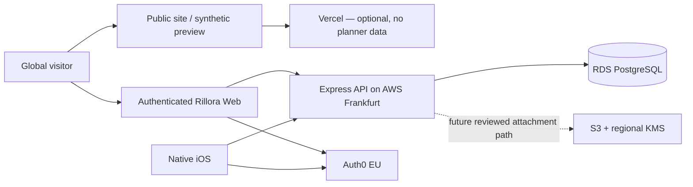
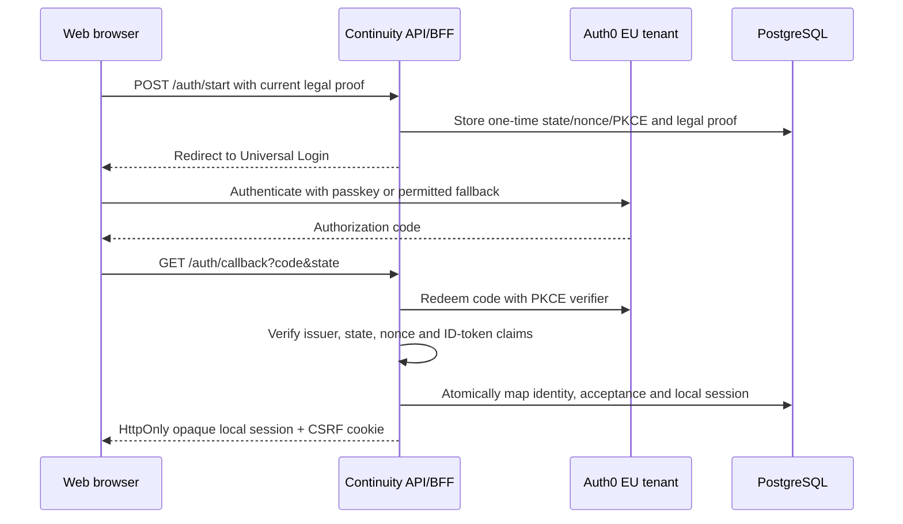

# Identity, Recovery And First Data Region

Role: production identity and first-region implementation contract  
Authority scope: provider boundary, login protocol, recovery baseline and first deployment-region candidate  
Superseded by: later reviewed decision recorded in `docs/decision-log.md`  
Do not use for: claiming production identity, completed recovery assurance, legal residency compliance or production deployment  
Status: AUTH0 EU / SYNTHETIC AWS FRANKFURT ACTIVE; IOS DIRECT HOSTED LOGIN SINCE SEPTEMBER 6; HOSTED APPLE CONFIGURATION RESTORED SEPTEMBER 9; INVITATIONS DEPLOYED SEPTEMBER 10; REAL RECIPIENT IDENTITY / PRODUCTION RECOVERY / RELEASE GATES OPEN  
Last updated: 2026-09-10 (documentation alignment; runtime evidence retains its dated checkpoint)  

## Current Decision

Public／legal hosting, zero-revenue cost control, domain allocation and future migration stages are governed by [`infrastructure-roadmap.md`](infrastructure-roadmap.md). The public legal artifact is live at `legal.rillora.xyz` through Sites and explicit GoDaddy DNS, with no product API／identity／database dependency. Sites／Cloudflare still process request metadata, expose aggregate traffic analytics and set a necessary host-only bot-protection cookie; this does not expand the Auth0 or application data region. The legal host does not use or promote the Frankfurt synthetic stack. Earlier Vercel／AWS public-site cost candidates in this file remain historical planning inputs.

首个生产平台角色分工是：

- 身份：Auth0 EU tenant，Web使用Universal Login与OpenID Connect Authorization Code + PKCE；
- iOS：原生SwiftUI的Profile身份入口及私有操作直接进入 `login.rillora.xyz` 的系统托管认证事务；2026-09-06决定已取代9月4日原生／hybrid Account、邮箱预填及独立法律页。同一托管事务收集未预勾选的必要协议并返回精确版本凭证；邮箱优先，Google／Apple／passkey按真实托管可用性显示。9月9日Apple连接替换密钥与入口恢复已回读，实际本人Apple回调仍单独验证。系统Code + PKCE后由API验证provider token及当前协议凭证，换取Rillora不透明Bearer；Keychain只保存本产品会话，不持久化Auth0 access/refresh token。取消回到来源并保留意图；旧原生适配器与截图仅为历史配置证据，不能恢复为当前主入口。
- 认证后的Rillora Web、API与业务数据：以AWS Frankfurt `eu-central-1`作为核心部署平面；
- 数据服务：PostgreSQL/RDS、S3和单区域KMS保持在同一区域，跨区域复制默认关闭；
- Vercel：只允许承载公开官网、帮助内容或不含真实身份／规划者数据的预览；不承载生产API，不代理认证后的规划者响应，不接收Rillora会话Cookie；
- 系统记录：PostgreSQL继续是可更正、可撤销、可删除的链下权威源。

平台角色分工已由Owner批准。2026-08-12已创建Auth0 EU Free开发租户和第一套合成数据AWS Frankfurt staging；Owner已购买`rillora.xyz`并为Auth0验证添加付款卡。当前云面包含API Gateway、VPC Link、Cloud Map、Fargate Spot、私有Single-AZ RDS、Secrets Manager、私有S3、CloudFront和区域日志；这证明精确资源与运行状态，不证明生产尺寸、付费成本上限、目标司法辖区完整数据驻留、生产密钥治理或真实敏感数据批准。Vercel项目仍未创建，付款卡和credits都不等于零费用保证。

Frankfurt staging的正式Web域为`https://app.staging.rillora.xyz`；同源`/api/*`只代理到现有API Gateway。ACM在`us-east-1`签发精确域的`EC_prime256v1`证书，CloudFront使用唯一alias和TLS 1.2_2021，GoDaddy权威DNS及Cloudflare/Google公共解析均指向当前分配。Auth0 Web callback/origin/logout白名单包含正式域并暂留localhost与原CloudFront hostname作回滚；API运行环境的callback与CORS origin已经精确切到正式域。公开首页、`/account` SPA回退、无错误会话探测、未认证401、登录303、CSP/HSTS、TLS/CORS和API Gateway数据库readiness均已实测。这里的“正式域”只描述staging入口，不代表生产环境或真实敏感数据批准。

2026-08-09，Owner进一步明确批准“先使用Free进行开发”。注册时自动生成的空`US-5`租户已按Owner确认删除，随后建立`rillora-dev.eu.auth0.com` EU Free开发租户。官方Auth0 CLI `1.32.0`用于可审计配置；官方Auth0 MCP虽存在，但当前仍为Beta且未安装到本会话，因此不作为本轮执行依赖。租户内最初以`Rillora Web Development`、`Rillora iOS Development`注册Web与原生客户端，并创建受众`urn:rillora:api`的`Rillora API`；2026-08-11只改其面向用户的显示名为`Rillora Web`与`Rillora iOS`，client ID、类型、回调与协议边界不变。API使用RS256、15分钟access token、无offline access，且只开放`session:create`。Web回调固定为`http://localhost:4173/api/auth/callback`；iOS开发回调固定为`com.rillora.ios://rillora-dev.eu.auth0.com/ios/com.rillora.ios/callback`。使用两个`.invalid`合成账号分别完成真实Web登录／退出和iOS系统浏览器登录／退出；iOS在进程重启后仍能从Keychain恢复Rillora会话。验证后两个合成Auth0用户及其本地合成planner行已按精确身份删除。该阶段没有填写账单、保存真实用户数据或创建AWS/Vercel资源、域名与生产密钥；后续域名和付款卡变化由下段单独记录。

同日，Owner确认已购买`rillora.xyz`，注册局RDAP显示该域名已登记并委派到GoDaddy `ns73/ns74.domaincontrol.com`。根域保留给未来公开站；Auth0创建`login.rillora.xyz`托管证书自定义域，并返回CNAME目标`rillora-dev-cd-k3ahlphxomlhvypl.edge.tenants.eu.auth0.com`。GoDaddy v3 API先回读无`login`冲突，再以HTTP 201创建TTL 600的唯一CNAME，随后回读记录总数由7增至8且值一致。`.xyz`父区随后发布NS委派，Google与Cloudflare均返回TTL 600的正确CNAME。Auth0随后把资源升级为`ready / verified`，托管Let’s Encrypt证书为`provisioned`，并将其设为默认主自定义域；HTTPS和OIDC discovery均返回`https://login.rillora.xyz/` issuer及同域授权、token、JWKS与logout端点。Web API在该issuer下用一次性`.invalid`合成身份完成Universal Login、Cookie会话、计划读取和退出，数据库回读的issuer也完全一致；合成Auth0用户、本地planner级联和临时钥匙串项随后精确删除，残留身份映射为零。iOS白名单和Debug配置已在保留旧租户回调作回滚的同时切到`com.rillora.ios://login.rillora.xyz/ios/com.rillora.ios/callback`，XcodeGen、44项测试、Debug安装启动和Release模拟器构建通过。2026-08-10又以独立一次性`.invalid`合成身份在iPhone 17e Simulator重跑新域原生路径：系统浏览器在`login.rillora.xyz`完成Code + PKCE，API数据库记录精确自定义issuer并签发`native_bearer`会话，客户端读取共享计划、进程重启后从Keychain恢复，再通过退出把会话标为撤销；Auth0日志同时记录成功认证、code交换和logout。该Auth0用户、本地planner级联、会话与临时钥匙串项随后精确删除，残留身份映射和活动会话均为零。测试过程中模拟器“密码”App误存的一条合成测试凭据已移入“已删除”而未永久清空，真实用户凭据未被使用。Auth0未设置更宽的RP ID，因此默认使用完整`login.rillora.xyz`；该较窄边界优于把整个`rillora.xyz`根域交给未来所有子域。当前没有真实用户，旧虚拟Passkey也已删除，因此不存在需要迁移的用户凭据。GoDaddy PAT保存在Owner本机钥匙串且未写入仓库；Owner临时授予了超出所需的权限，现应轮换为仅`domains.domain:read`与`domains.dns:update`。

一次只读GoDaddy v1域名详情检查意外返回并在工具输出中显示了EPP转移授权码；该字段不是本任务所需，后续查询禁止输出完整响应，临时文件已删除。域名继续保持`ACTIVE / locked / privacy on / auto-renew on`，且GoDaddy返回最早可转出时间为2026-10-08。锁定和60天限制降低了当前滥用可能，但不能把暴露视为无效；GoDaddy公开API与`gddy`当前没有重新生成该码的操作，Owner应在GoDaddy账户或通过官方支持完成轮换，并且在轮换前不得解锁域名或启动转出。

同日的下一轮合成身份验证启用了New Universal Login的Identifier First，以及数据库连接中的password + passkey并存、按钮／autofill、渐进注册和本地注册。隔离的Chrome虚拟WebAuthn认证器完成一次密码首次登录、Passkey注册和两次后续Passkey登录；Auth0日志分别记录`gd_enrollment_complete`和`performed_amr: ["phr"]`。这证明开发租户的Web Passkey路径，不代表真实Apple Keychain、生物识别、iOS原生Passkey、生产Release身份或账户恢复。第三个`.invalid`合成Auth0用户及其本地planner行也已在验证后精确删除。

2026-08-11，默认本地Web启动先从只用于UI QA的开发规划者直达恢复为真实身份边界：API以`ALLOW_DEV_AUTH=false`运行，Web不设置`VITE_DEV_PLANNER_ID`，因此未认证的`/v1/session`与即使携带开发身份头的请求都返回401。随后Owner纠正入口信息架构：401仍保护所有私有计划API，但根路径不再把登录墙作为第一屏，而是显示无需账户的公开产品说明；开始计划和`Account`进入独立`/account`页面后才明确提供`Sign in`与`Create account`。后者只通过服务端允许的精确`screen_hint=signup`进入注册页，其他hint被忽略。Auth0数据库连接的本地注册继续开启，登录页与注册页均通过`login.rillora.xyz`可见；本轮只检查页面与字段，没有填写凭据或创建真实账号。租户friendly name设为`Rillora`，Universal Login主色与背景更新为Calm Continuity的`#CB704C / #F4EFE6`；最终Logo尚未批准，因此没有设置虚假的正式Logo或favicon。

同日稍后，Owner明确授权使用其自有邮箱作为首个人工试用账户，并要求不再使用开发规划者。后端因此拆分Web机密客户端与原生公开客户端的配置契约：iOS access token验证只接收issuer、native client ID和API audience，不再为启动原生链路而要求无关的Web client secret；生产Web身份签发仍必须是完整配置。本地API在4180以`ALLOW_DEV_AUTH=false`启动，未认证和伪造开发身份头均返401；iPhone 17 Pro Max Debug在无planner override下重建，并已到达`login.rillora.xyz`真实登录页。此时还没有输入Owner邮箱，也没有证明注册、邮件验证、本地身份映射或Bearer会话已完成。

## Deployment Role Allocation

部署边界如下：

- `www`等公开内容可以使用Vercel；只使用公开或合成数据，分析脚本仍需隐私审查；
- 登录后的Web静态资源、API、数据库、审计和未来密文对象进入AWS控制面；确切静态托管与CDN路径在数据流审查后确定；
- API保持当前Express常驻服务模型。合成数据staging先使用API Gateway HTTP API + VPC Link + Cloud Map + 单个ECS Fargate任务；真实敏感数据前必须重新审查私有子网出口、冗余、WAF/CDN和是否改用ALB；
- PostgreSQL首选RDS；开发／验证环境可用Single-AZ且禁止真实敏感数据，真实数据环境必须重新评估Multi-AZ、恢复时间和备份保留；
- 未来文件使用私有S3桶、版本与生命周期规则、区域KMS信封加密；当前文件写入能力继续关闭；
- Secrets Manager、CloudWatch、CloudTrail、WAF、预算告警和分离的runtime／migration／operator身份属于真实数据前的生产门；
- AWS基础设施必须使用可审阅的Infrastructure as Code。由于应用栈为TypeScript，AWS CDK TypeScript是当前`PROVISIONAL`默认；未获外部资源授权前不执行bootstrap或deploy。

## Resource And Cost Envelope — PROVISIONAL

以下是2026-08-09的规划区间，不是报价、预算批准或可用性证明。创建资源前必须在AWS Pricing Calculator、Auth0和Vercel当前结账页重新计算，并设置硬预算告警。

| Stage | Planned resources | Planning envelope |
| --- | --- | --- |
| 自动化本地验证 | 本地PostgreSQL仅供测试、无Owner交互数据、无云资源 | `$0/month`外部基础设施 |
| 身份联调 | Auth0 EU开发租户；本地Web/iOS回调；无真实用户 | 当前Free层可能覆盖；若需要独立生产／开发环境、增强MFA或日志流，按当前公开价预留约`$35+/month` |
| 精简AWS staging | API Gateway HTTP API、VPC Link/Cloud Map、1个ARM Fargate `0.25 vCPU / 0.5GB`任务、1个公网IPv4、小型Single-AZ `db.t4g.micro` RDS PostgreSQL、20GB GP3、2个Secrets Manager秘密与少量日志；只用合成数据 | 2026-08-11 AWS Price List基础项约`$29.45/month`；加API请求、日志、ECR、流量、税费和误差按`$30–40/month`规划，建议`$50/month`预算告警。Free Tier/credits只作抵扣，不作零账单保证 |
| 真实数据前基线 | 至少2个跨AZ任务、受控出口、WAF、Multi-AZ RDS、备份、秘密管理、审计与告警 | 约`$250–600/month`，不含人工安全／法律服务、邮件、域名、税费和高流量 |
| 可选公开站 | Vercel仅承载公开内容 | Pro当前为`$20/month`含一个部署席位；也可先不启用 |

精简staging不是生产降级版：Single-AZ、低冗余或Free层只能使用合成数据。任何真实规划者数据进入前，必须独立批准预算和生产门，不能因为“staging跑通”自动升级。

2026-08-11复算使用Frankfurt公开Price List：RDS实例`$0.019/hour`约`$13.87/month`，20GB GP3按`$0.137/GB-month`约`$2.74`，ARM Fargate约`$8.29`，一个公网IPv4约`$3.65`，两个Secrets Manager秘密`$0.80`，Cloud Map资源约`$0.10`；HTTP API首档为`$1.20/million requests`。AWS新账户当前可能通过Free计划获得限时credits，但资格和余额必须登录目标账户实时确认，不能从公开页面推断。

同日对目标账户完成只读核查：Free Plan为`ACTIVE`，计划余额`$100 USD`并显示`2027-02-11`到期；Billing Credits API另显示一笔剩余`$100 USD`、覆盖260项产品、`2027-08-11`到期的Promotion。前者是账户计划期限，后者是具体credit期限，不能择取更晚日期来推断免费服务持续时间。随后Owner批准低成本方案并建立无Access Key的MFA `rillora-operator`、CDK角色和最小权限staging operator；根账号退出，bootstrap管理员策略关闭。Frankfurt现有活动Rillora栈与25美元月度Cost Budget；Budget没有通知收件人，不构成告警送达证据，也不是自动硬停。

## Protocol And Data Boundary

iOS不复用上述Cookie。Hosted fallback仍可由Auth0.swift通过系统浏览器Code + PKCE取得短期API access token；原生Apple／Google／Passkey在对应协议完成后也由Auth0签发同一API audience的短期access token。客户端只把该token与当前精确法律proof提交给`POST /auth/native/session`；API使用Auth0 EU JWKS验证`issuer / audience / RS256 / sub / exp / iat / azp / scope`，确认`azp`等于原生client ID且包含`session:create`后，签发`native_bearer`类型的Rillora不透明会话。Web的`browser_cookie`会话不能作为Bearer使用，原生Bearer也不能当Cookie使用；Rillora不接收Auth0密码或Google／Apple凭据。

- 身份主键仍是提供商 `issuer + subject`，不按邮箱合并账户。显示名／locale可初始化规划者资料，会话记录认证时间／方法。账号绑定邀请现请求并验证 `email` scope：原始邮箱不作身份主键；精确匹配摘要与遮罩用于目标接收检查，摘要仍属个人数据。旧会话没有已验证邮箱时只能继续普通计划，不能接受定向邀请。API不持久化Auth0 access/refresh token。
- 浏览器不把认证令牌放进`localStorage`、URL或可读JavaScript状态；应用状态使用同源BFF Cookie会话。
- 登录事务短时、一次性使用；state和外部事务Cookie按哈希匹配，PKCE verifier与nonce只在未完成事务中短期保存。
- 创建账户只使用受控的同源登录入口与精确`screen_hint=signup`；不把任意查询值转发给身份提供商。
- 会话令牌和CSRF令牌只以SHA-256摘要存入数据库；生产Cookie使用`HttpOnly`、`Secure`与`SameSite=Lax`。
- 回跳地址只允许当前Web同源下的相对路径，禁止开放重定向。
- 生产环境缺少完整OIDC配置或尝试开启开发身份头时，API拒绝启动。
- Auth0 client secret只在本地API进程环境中注入，没有进入仓库、iOS bundle、Web bundle或文档；原生client是public client，不持有client secret。

## Passkey And Recovery Baseline

首选正常登录是passkey；但“有passkey”不等于账户恢复已经安全。真实用户进入前必须完成：

1. 明确允许的备用登录/恢复因子，不用仅凭可被接管的邮箱静默重置；
2. 新设备、添加/删除passkey、恢复开始、恢复完成和会话批量撤销的多通道通知；
3. 高风险恢复后的观察期或敏感操作冻结；
4. 用户可查看并撤销其他会话，支持丢失设备场景；
5. 对邮箱接管、SIM交换、客服社会工程、旧设备和恶意可信联系人进行账户接管测试；
6. 将产品中的可信联系人与账户恢复人分离，可信联系人默认不能恢复或接管规划者账号。

当前EU开发租户已使用New Universal Login + Identifier First，并同时启用password与passkey；Passkey UI允许按钮和autofill，progressive/local enrollment均开启。隔离的虚拟WebAuthn认证器已证明Web渐进注册与`phr`登录，且首次注册前的密码登录证明密码备用入口仍存在。没有使用Owner真实Apple Keychain、生物识别或邮箱。

恢复接口以一个存在和一个不存在的`.invalid`合成邮箱各调用一次，两次都返回相同的`200`与通用文案，没有在客户端响应中暴露账号是否存在；存在账号的邮件随后因`.invalid`域没有MX/A记录而失败。这只证明响应一致性，不证明模板、真实邮件投递、链接消费、改密后的旧会话撤销或恢复安全。Guardian因子、备用因子、恢复通知、高风险恢复冻结与真实设备恢复仍未验证。

Rillora已实现`POST /v1/auth/logout-all`，按服务端规划者身份撤销其全部本地Cookie/Bearer会话，并明确返回`identityProviderSessionsRevoked: false`。真实浏览器验证一次撤销了同一合成规划者的三个会话；集成测试同时证明第二个规划者不受影响。Auth0提供商会话仍是独立边界：当前Free租户不能使用Enterprise限定的Management API用户会话端点，因此不能把“退出所有Rillora设备”描述为退出所有Auth0 SSO会话。

当前租户的Brute-force Protection和Suspicious IP Throttling均开启并执行阻断；Breached Password Detection关闭，官方当前将其列为Professional／Enterprise能力。不得把Free层基础攻击防护升级描述为完整账户接管防护。

## First Region Boundary

AWS Frankfurt `eu-central-1`作为首区候选的目的，是先建立清晰、可审计的单区域边界，而不是声称“覆盖整个全球”：

- PostgreSQL/RDS、对象存储与KMS密钥同区创建；
- S3不启用跨区复制；备份、日志、分析和支持导出也必须纳入区域清单；
- KMS使用信封加密：数据密钥加密字段/对象，区域KMS密钥只包装数据密钥；
- 身份数据与业务数据是两个边界：Auth0 EU tenant不能自动证明所有应用数据都位于欧盟；
- 后续进入其他地区时优先创建独立数据平面，不做一个全球共享的敏感资料库；
- 删除、备份过期、密钥轮换、灾备和跨境支持访问必须在部署前形成可测试的运行手册。

数据区不等于销售／法律开放区。Owner已锁定个人身份首发，但个人居住／税务国家和第一个公开用户市场仍未在仓库中确定。当前区域开放合同是：先选择一个英语首发市场；EU/EEA、UK和中国大陆默认关闭；App Store storefront allowlist、Web市场资格、隐私／条款、支持能力和支付可用性必须引用同一版本化市场登记。Frankfurt staging只证明合成数据部署位置，不能自动证明向欧盟用户提供服务、GDPR Article 27、DSA trader disclosure或任何市场的跨境机制已经解决。完整市场与未来转公司路线见[`individual-operator-launch-plan.md`](individual-operator-launch-plan.md)。

中国大陆不复用Frankfurt/Auth0 Global平面作为默认生产数据路径。Mainland 的首选部署已收敛为**阿里云华南 1（深圳）**：使用满足备案条件的内地 ECS、跨可用区无状态应用、RDS PostgreSQL 高可用、私有 OSS、KMS、WAF 和 SLS；受限 beta 和公开收费的具体规格／预算在[`global-mainland-commerce-plan.md`](global-mainland-commerce-plan.md)维护。这个选择不授权购买资源，也不证明备案／许可完成。

架构仍是一套共享领域模型和API合同、两套可独立运行的地区适配层：Global继续以Auth0/Frankfurt作为当前候选，Mainland 使用本地身份、接入、数据、支付、法律和支持路径。两区账户不得默认合并，敏感计划不得自动跨境同步；未来任何迁移都必须是用户明确发起、最小化、可审计并满足当时适用的跨境机制。是否拆成两个App Store binary晚于这一数据/能力边界决定，不能仅为“看起来分区”提前复制代码库。

## Live-Configuration Gate

真实配置完成标准至少包括：

- 已完成：Auth0 EU Free开发租户、Web与原生iOS应用、API受众及本地精确回调/登出URL；Owner已购买`rillora.xyz`，Auth0 `login.rillora.xyz`资源和GoDaddy CNAME已创建；
- 已完成：`.xyz`委派、公共CNAME、Auth0验证、托管TLS、默认主自定义域、同域OIDC discovery与Web新issuer合成身份登录／读取／退出；
- 已完成：Web Universal Login Code流程和iOS系统浏览器Code + PKCE、typed local session、重启恢复与退出撤销的合成身份验证；
- 已完成：默认localhost允许公开浏览并把`/account`作为显式登录／创建账户选择面；私有API继续失败关闭，Auth0自定义域登录页和注册页可到达；本轮没有创建真实账号或完成新登录；
- 已完成：隔离虚拟WebAuthn认证器下的Web Passkey渐进注册与`phr`登录；
- 已完成：Rillora本地会话批量撤销和跨规划者隔离；
- 已完成：iOS Debug域、Auth0回调／登出白名单、`login.rillora.xyz`下的原生登录／Bearer交换／共享API读取／重启恢复／退出撤销、XcodeGen、44项测试、Debug安装启动与Release模拟器构建；
- 已完成配置回读：Debug Associated Domains、Auth0 Device Settings、AASA、WebAuthn grant与200 challenge；这不证明Passkey注册／登录。待完成：真实原生Passkey闭环与Release身份参数；
- 未完成：真实Apple设备/iOS原生Passkey、备用／Guardian因子、真实恢复邮件和链接消费、Auth0提供商会话批量撤销、恢复后冻结与完整账户接管测试；
- AWS `eu-central-1`隔离环境、最小权限运行/迁移身份、RDS、S3、KMS与日志区域核查；
- 生产密钥通过部署平台秘密管理注入，仓库和客户端不出现长期凭证；
- DPIA、供应商数据处理条款、目标法域法律审查和独立安全复核。

在以上门通过前，`authenticationIssuance`、真实附件、真实邀请、真实申请和真实披露继续报告为关闭。

## Current Official Sources

- [Auth0 database connections and passkeys](https://auth0.com/docs/authenticate/database-connections)
- [Auth0 passkey policy](https://auth0.com/docs/authenticate/database-connections/passkeys/configure-passkey-policy)
- [Auth0 passkey APIs](https://auth0.com/docs/authenticate/database-connections/passkeys/passkey-apis)
- [Auth0 tenant regions](https://auth0.com/docs/get-started/auth0-overview/create-tenants)
- [Auth0 Authorization Code with PKCE](https://auth0.com/docs/api/authentication/authorization-code-flow-with-pkce/authorize-with-pkce)
- [Auth0 iOS Swift quickstart](https://auth0.com/docs/quickstart/native/ios-swift)
- [Auth0 session management](https://auth0.com/docs/manage-users/sessions)
- [Auth0 Management API user sessions](https://dev.auth0.com/docs/manage-users/sessions/manage-user-sessions-with-auth0-management-api)
- [Auth0 change-password endpoint](https://auth0.com/docs/api/authentication/change-password/change-password)
- [Auth0 breached-password detection](https://auth0.com/docs/secure/attack-protection/breached-password-detection)
- [Apple passkey support](https://developer.apple.com/documentation/authenticationservices/supporting-passkeys)
- [Auth0 CLI](https://auth0.github.io/auth0-cli/)
- [Auth0 MCP server](https://github.com/auth0/auth0-mcp-server)
- [Auth0 first-party applications](https://auth0.com/docs/get-started/applications/first-party-and-third-party-applications)
- [AWS RDS regions](https://docs.aws.amazon.com/AmazonRDS/latest/UserGuide/Concepts.RegionsAndAvailabilityZones.html)
- [AWS Encryption SDK envelope encryption](https://docs.aws.amazon.com/encryption-sdk/latest/developer-guide/how-it-works.html)
- [AWS KMS cryptography](https://docs.aws.amazon.com/kms/latest/developerguide/kms-cryptography.html)
- [Amazon S3 bucket regions](https://docs.aws.amazon.com/AmazonS3/latest/userguide/UsingBucket.html)
- [AWS privacy and data-location controls](https://aws.amazon.com/compliance/privacy-features/)
- [Vercel Express deployment model](https://vercel.com/docs/frameworks/backend/express)
- [Vercel regions and default compute region](https://vercel.com/docs/regions)
- [Vercel Pro plan pricing](https://vercel.com/docs/plans/pro-plan)
- [Auth0 current pricing](https://auth0.com/pricing)
- [AWS Fargate pricing](https://aws.amazon.com/fargate/pricing/)
- [Amazon RDS for PostgreSQL pricing](https://aws.amazon.com/rds/postgresql/pricing/)
- [Amazon RDS regional backup storage](https://docs.aws.amazon.com/AmazonRDS/latest/UserGuide/USER_WorkingWithAutomatedBackups.html)
- [AWS Free Tier credits and six-month free plan announcement](https://aws.amazon.com/about-aws/whats-new/2025/07/aws-free-tier-credits-month-free-plan/)
- [AWS Free Tier FAQ](https://aws.amazon.com/free/free-tier-faqs/)
- [AWS Price List bulk API](https://docs.aws.amazon.com/awsaccountbilling/latest/aboutv2/price-changes.html)
- [API Gateway private HTTP integrations](https://docs.aws.amazon.com/apigateway/latest/developerguide/http-api-develop-integrations-private.html)
- [ECS Fargate outbound networking](https://docs.aws.amazon.com/AmazonECS/latest/developerguide/networking-outbound.html)
- [Amazon VPC pricing](https://aws.amazon.com/vpc/pricing/)
- [Amazon API Gateway pricing](https://aws.amazon.com/api-gateway/pricing/)
