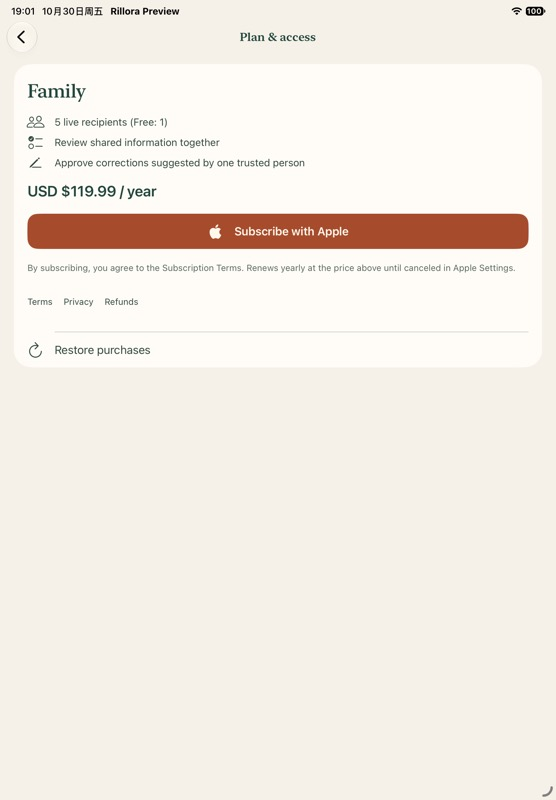
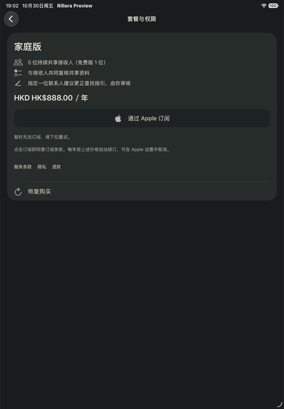

# October30 App Store拒审修复

Status: BACKEND DEPLOYED / LOCAL15 READY / RESUBMISSION HELD / SOURCE PUBLICATION IN PROGRESS
Date: 2026-10-30 (Asia/Shanghai)

[当前合同](../../../docs/app-review-remediation-20261030.md)及[唯一下一步](../../../docs/handoff.md)记录Owner“先别重新提交”。本轮保存到现有协作分支，原14仍Rejected，15仅本地签名；没有上传、重新提审、TestFlight或新真钱交易。

## 原因与线上修复

- [Apple原文](apple-message.reference.txt)和原始图[11:32](Screenshot-1030-103219.png)、[11:33](Screenshot-1030-103305.png)：2.2／2.1(b)，价格已显示但购买禁用。
- [实际运行诊断](runtime-diagnosis.json)：审核资格October27到期，AppleOctober30审核。不是产品必须先批准的推断。
- [具名续期](renew-review-receipt.json)与[独立后读](inspect-after-receipt.json)：仅专用审核登记改变，其他价格／路线／账号／内容保持。
- [运行更新](production-expiry-deployed.json)：旧模板、镜像、秘密引用及其他参数不变，API滚动完成。
- [监控部署](operations-deployed.json)及[实际15项报告](operations-fresh-health-report.json)：提前7天检查，原15分钟调度及1个已确认订阅者保持。没有新的邮件投递演练。
- [新协议接受](developer-license-accepted.json)和[商店状态](apple-store-readback.json)：接受日期October30，App14仍被拒、手动发布。完整账户截图不入Git。

## 验证及候选

[45项购买／恢复逻辑](native-commerce-en-result.json)、[1项实际本地StoreKit SDK](native-storekit-sdk-result.json)、[12项健康检查](health-deadline-tests.log.txt)、[12项基础设施检查](operations-infra-tests.log.txt)和[11项静态检查](static-checks.json)通过。[原始失败及限制](failures-and-limits.json)保留，完整日志和xcresult在archive55。没有伪造Apple Sandbox或实体设备付款。

[合成iPad矩阵](preview-acceptance.json)验证正常与不可用分支，运行时27.0，不冒称审核员27.2。

[精确源码隔离](native-source-isolation.json)以原14的bfe9baaf5为底，只叠加[购买补丁](native-hotfix.patch)、测试设置和明确构建号；生成工程只因独立目录名改变两个配置资源标识。下一版HealthKit／Watch／Duo／内容没有打包。[Release签名核对](native-archive-readback.json)及[本地IPA导出](native-app-store-export.json)为1.0(15)，未上传。

[审核回复草稿](review-response-draft.reference.txt)尚未发送，Owner恢复提交前不得当成已回复或将准备态写成提交态。

## 保存与复核

[新增archive55](snapshot.json)保留本次674路径／482对象／34,208,163密文字节，包括原始失败、本地源码／候选及最终IPA；[本机认证](archive-verification.json)通过。旧1–54不重封、不重下。[保存回执](preservation-receipt.json)与[阅读范围](reading.json)分别记录可读材料、排除项和正文阅读沿用链。AWS秘密、维护能力、登录屏和私人提供方响应排除；SourcePackages／DerivedData／CDK中间产物为可重建缓存。

最后一份回执后必须重建全量可读清单并用确切main基线执行本机发布门；远端提交、archive55独立新下载认证和无新云端作业另行读回。Git保存与本地候选不代替Apple批准，当前不合并／部署下一版新功能。
