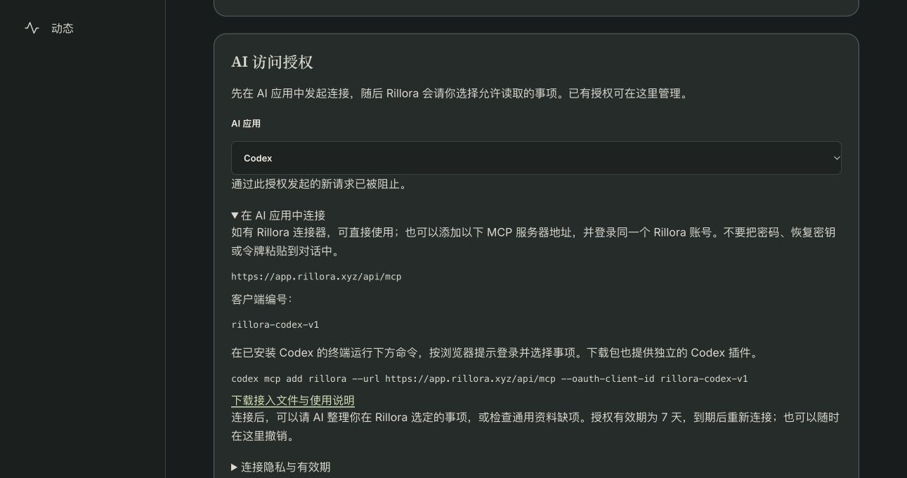

# 正式MCP、Google地图及Registry交付

Status: LIVE ACCEPTANCE / SOURCE CI187 / REMOTE ARCHIVE VERIFIED / OPENAI IDENTITY DEFERRED
Last updated: 2026-10-18 (Asia/Hong_Kong)

Owner要求普通用户真正可用，保持当前审核并推Git。本目录保存当次新增工作，完整阅读链见[reading](receipts/reading.json)；更早的1—47归档不重复封存。当前合同见[正式MCP](../../../docs/architecture/customer-mcp-20261018.md)与[Google地图](../../../docs/architecture/google-sitemap-20261018.md)。

| 实际结果 | 可读回执 |
| --- | --- |
| 官网66文件交付、旧页面保持 | [逐文件HTTP](receipts/public-live-http.json)、[部署验证](receipts/public-live-verified.json) |
| Google中英文各14URL成功处理 | [真实GSC读回](receipts/google-readback.json) |
| 103→106迁移、68旧表指纹及权限保持 | [前后比较](receipts/production-migration-comparison.json) |
| 独立OAuth秘密受保护保存 | [秘密安装边界](receipts/oauth-secret-installed.json) |
| 精确Host修正与公开issuer交付 | [Host结果](receipts/hostfix-verified.json)、[API部署](receipts/canonical-deployment-verified.json)、[公开发现](receipts/canonical-live-endpoints.json) |
| 正式Web及单语言标签最终89文件 | [精确交付](receipts/web-language-deployment-verified.json)、[逐字HTTP](receipts/web-language-live-http.json)、[浏览器标签](receipts/web-language-browser.json) |
| 真实Codex模型调用、选择范围及立即撤销 | [综合验收](receipts/codex-production-acceptance.json)、[模型回执](receipts/codex-consumer-model.json)、[撤销后客户端](receipts/codex-after-revoke.json)、[凭据清理](receipts/codex-credential-cleanup.json) |
| 当前Codex从正式下载包解析插件 | [实际解析器](receipts/customer-plugin-parser.json) |
| 官方Registry发布及公开active | [独立验证](receipts/registry-verification.json)、[公开读回](receipts/registry-public-readback-v0.json)、[DNS保持](receipts/registry-dns-applied.json) |
| 源码CI186及最终实现CI187三任务通过 | [语言修正CI](receipts/language-source-ci.json)、[CI187](post-capture/package-source-ci.json) |
| 新归档本地认证及完整目录 | [本地验证](archive-verification.json)、[逐文件目录](catalog.json)、[快照](snapshot.json) |
| 新归档GitHub独立下载／认证 | [远端回执](remote-readback.json) |
| 最后安装包元数据更新已发布 | [实际公共下载](post-capture/package-download-live.json)、[窄范围部署](post-capture/web-package-deployment-verified.json) |
| OpenAI本人身份门由Owner暂后 | [实际平台要求与Owner决定](post-capture/openai-publisher-gate.json)、[公开草稿ZIP](post-capture/rillora-openai-review-draft.zip) |

Archive48保存439条新路径、318个唯一对象、5,390,797密文字节，包括最终与初次Web产物、独立官网、最小部署模板、失败／修正记录、受限模型结果与安全截图。实际密钥、令牌、Cookie、能力URL、个人账号截图和数据库备份没有进入Git；生成的依赖／资产缓存及第三方源码副本按清单排除。

公开登记不等于OpenAI／Claude商店批准；Codex实际任务不代表所有消费端通过；Google发现28URL不代表全部收录、排名或推荐。生产令牌到期刷新未在这次真实客户端会话单独触发，HTTP协议／先前候选刷新结果保留原证据范围。当前App14、TestFlight暂停、原事项、价格、收费及FanPass均保持。

远端独立下载／解密核验已在abcaf2af18a09649a232c73591e93ae01a465d04完成，318对象／439路径匹配。该实现提交的CI187三任务全部成功；后续收尾只更新文档和回执，不重复应用部署或原生／付款测试。晚于加密捕获的无秘密[安装包与记录](post-capture/manifest.json)作为普通Git增补，不重封archive48。支持地址和Codex作者字段已补齐并实测公共下载，其他88文件保持。

Owner已登录OpenAI Platform，但上传入口必须先验证开发者身份；Owner明确稍后办理。本轮没有上传或提交OpenAI插件，没有完成其消费端测试／演示／审核，也没有创建付费服务或代选法律身份。保留现成草稿供以后接续。
