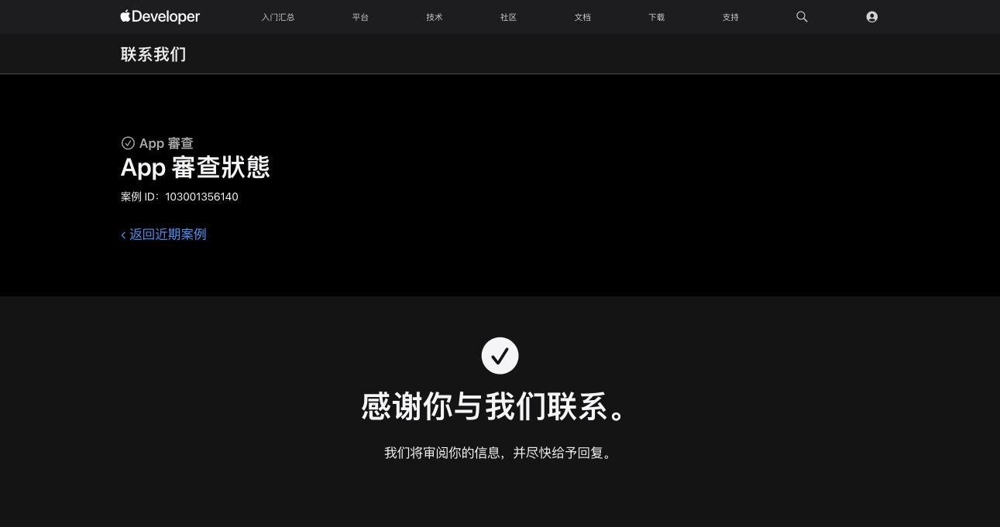
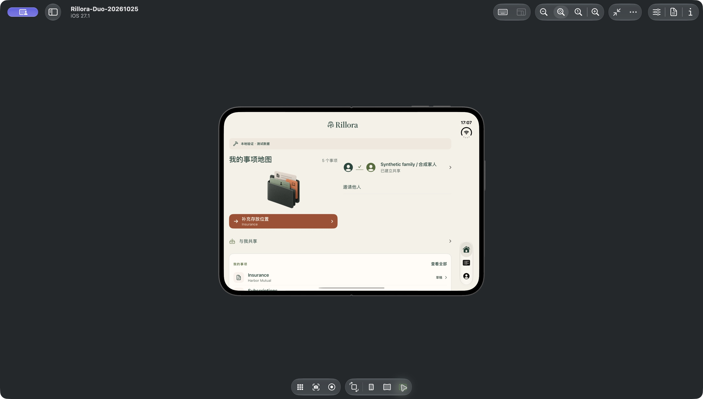
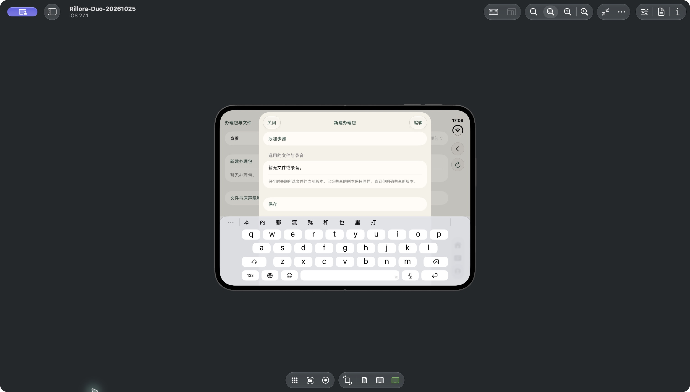
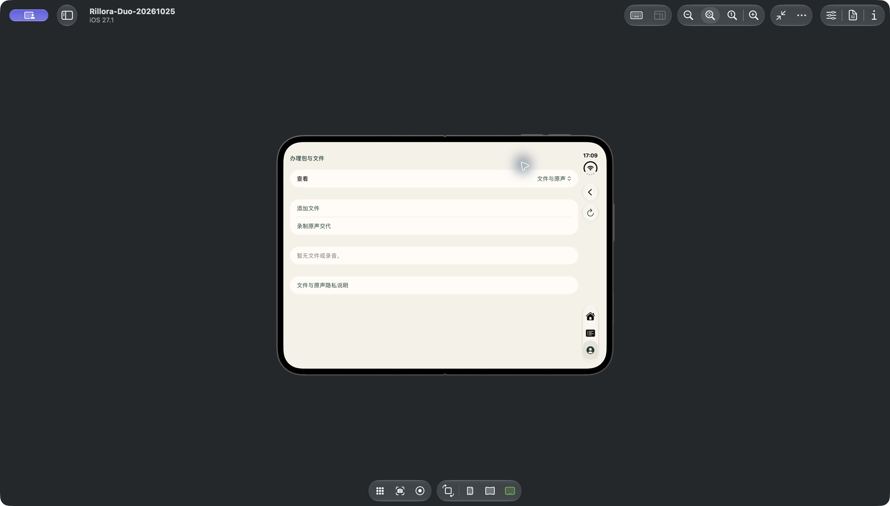

# October25 Duo本机验收与Apple跟进

Status: LOCAL ACCEPTANCE COMPLETE / SOURCE AND ARCHIVE PUBLISHED / REMOTE VERIFIED
Date: 2026-10-25 (Asia/Hong_Kong)

当前合同见[下一版Duo验收](../../../docs/iphone-duo-validation-20261025.md)。本轮只追加archive54；旧1–53不可变。分支`codex/health-checkin-watch-20261024`继续[PR10](https://github.com/tantalum666/rillora/pull/10)，archive54已本机认证2,834路径／1,793对象，密文227,149,556字节；[保留回执](preservation-receipt.json)。源码／归档已推送为`dfe3583e31a54b2b20f428b5e1496846c81e1332`。[确切候选匹配](source-commit-verification.json)、[本机发布门](local-publication-source/result.json)、[独立远端认证](remote-readback.json)及[PR／云端作业回读](github-source-readback.json)分别可查；PR10开放未合并，源码0云端运行。

## 已完成的证据

- [原普通旋转回归](rotation-final-summary.json)：中英文2通过、0失败／跳过；原用例保留并修正表单目标／局部坐标及放弃后的等待。
- [实际Duo直接验收](native-manual-acceptance.json)：官方iPhone19,4／iOS27.1，真实Closed／Partially Open／Open；中英文草稿保留、键盘上方保存、关闭／放弃／返回、系统文件选择器取消、禁用保存及返回；中文事项选择跨屏不变。它是原生操作证据，不是自动Duo套件全绿。
- [全部原始结果状态](all-xcresult-outcomes.json)：失败和中断不删除、不改写；混合XCTest探针因状态／输入可靠性不足移为参考，未留在活动工程或伪装跳过。原普通旋转用例仍活动。
- [新SDK Release检查](release-artifact-inspection.json)及[候选保留](candidate-preservation.json)：三份可执行文件无QA开关。本机模拟器候选不是可分发IPA。
- [当前审核六文件](review-source-final.json)逐字保持；[原本机合成计数](duo-content-counts-before.json)与[最终回读](duo-content-counts-after.json)均为办理包0／文件0／收到0；没有保存、上传或共享。
- [官方运行时完整性](runtime-download-verified.json)：完整SHA256匹配、TLS未关闭。安装后保留系统运行时，[32GB可重建下载中间数据已清理](vendor-cache-cleanup.json)，不进入Git。
- [Apple同案例跟进](apple-followup-receipt.json)、[发送正文](apple-review-followup.txt)与[再次刷新状态](apple-status-final.json)：原案103001356140确认收件；原1.0(14)三项仍等待审核，原因、ETA和结果未知。
- [清理回读](cleanup.json)：本轮合成API已退出、Duo模拟器Shutdown、未erase；临时MCP配置移除，Next工程恢复有效配置。

## 可直接查看的合成画面

其他原生截图、AX、原始失败／通过xcresult、日志和实验源文件由archive54及本目录catalog逐对象保存。Device Hub半展开系统选择器的3D预览模糊与[直接内屏清晰帧](images/manual-en-picker-partial-inner.png)分别记录。默认primary可能是未使用的外屏；实际内屏按枚举使用primary-1。

## 边界

当前审核／商店材料、生产、个人数据、定价／收费、FanPass及TestFlight未改。全部本机执行，未启用云端CI。没有声称实体Duo、真实健康／实体Watch、语音质量或硬件保护通过；既有相关门保留。没有派发新的子代理；后续即使审计或必要委派也先询问Owner。

[阅读链](reading.json)沿用既有完整正文阅读，补读当前权威和变动文件，不把摘要或哈希当全文阅读。源码自查见[主代理复核](primary-source-review.json)。最后一份回执写完后重建全量可读清单，用确切main基线运行本机发布门，再回读远端；push、验证和发布是三个不同结果。
