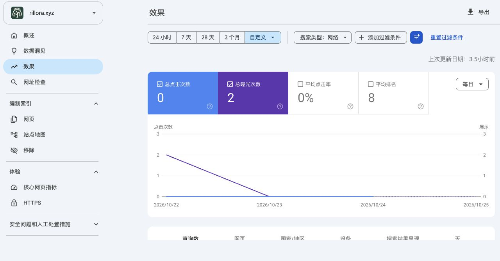

# Google Search Console初始实读

Observed: 2026-10-25 (Asia/Hong_Kong)
Recorded: 2026-10-26 (Asia/Hong_Kong)

[完整结论](../../../docs/marketing/google-search-baseline-20261025.md)。[搜索数值](performance.json)来自已登录的Google可见指标／维度表；[摘要截图](performance.png)去除了账号头像区域。[数据一致性检查](data-check.json)保留查询明细1次与总展示2次的差额，不补造查询或用户。

[旧索引总表](index-summary.json)仍标October16。[英文清单](english-checklist-index.json)和[中文清单](chinese-checklist-index.json)的索引检查均未收录；[中文实时测试](chinese-checklist-live.json)抓取成功、允许索引、canonical正确。可抓取不是已收录或已有自然访客。

[阅读链](reading.json)沿用此前完整阅读，补读当前权威与Google相关合同。[收尾记录](closeout.json)说明本轮观察边界和无需追加决策日志的原因。只保存这些无凭据的小型记录到Git，不创建新加密归档、不重下旧归档，不运行云端CI或应用回归。没有改网站、申请索引、重提地图、投广告、动审核或收费；CSV下载事件超时也未冒称导出成功。
