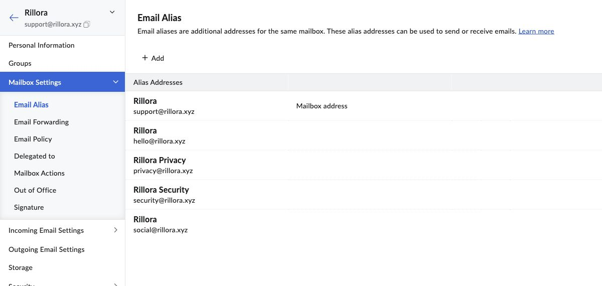

# 营销邮箱别名配置与收发验证

Status: ALIASES CONFIGURED / BOTH SEND-RECEIVE VERIFIED / INITIAL RETRY SEPARATELY RECORDED
Last updated: 2026-10-19 (Asia/Hong_Kong)

Owner明确要求为现有Zoho邮箱添加social@rillora.xyz和hello@rillora.xyz并验证收发，不购买新邮箱。本轮是同一营销工作流的延续，完整阅读链与补读范围见[reading.json](reading.json)，盘点见[markdown-inventory.json](markdown-inventory.json)。

Owner已恢复原Zoho登录；后台普通刷新恢复加载。两个别名均保存到原support邮箱，主地址及privacy/security保持，Mail Lite仍为1用户／1许可证。原准备／登录阻塞记录保留为历史，当前以[验收结果](acceptance.json)和[实际配置前后](zoho-before.json)／[创建后](zoho-after.json)为准。

两封Gmail测试已在[Zoho INBOX实际收到](zoho-inbound-verified.json)。[hello回复](hello-external-verified.json)和[social独立发信探针](social-external-verified.json)都实际进入Gmail INBOX，From／收件人／主题／正文正确，Google SPF、DKIM、DMARC均pass。

首封social回复另有[Google4.3.0临时拒收](social-temporary-retry.json)，由Zoho自动重试。为确认当前发信能力，只增加一封独立编号探针，不手动重发原邮件、不取消队列。共提交5封目的限定测试，4封在对端收件箱实读；不能把原首封也写成已送达。没有购买、DNS／Resend变更、平台账号注册或营销外发。

聚焦合同：[mail-aliases-20261018](../../../docs/marketing/mail-aliases-20261018.md)。产品入口、decision-log、handoff、营销执行计划和PROJECT_JOURNEY已更新Owner指令、配置及真实结果；原MCP／地图／Registry成果和暂后的OpenAI身份门不重做。没有应用代码改动，因此不重复API／iOS／付款或部署测试；[链接检查](markdown-links.json)为本轮文档验证。

登录及原始邮件／错误截图只在本机保护目录，没有密码、OTP、会话或私人邮箱内容进入Git。少量安全记录以普通Git保存，不重新封存或下载此前48份归档；本记录证明所列样本，不是持续SLA、所有平台收件或未来绝不进垃圾邮件的承诺。
