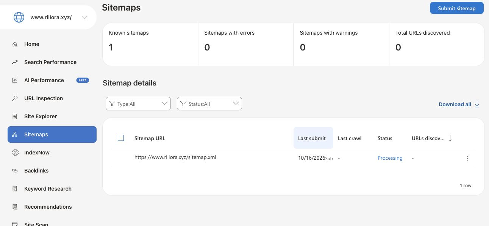
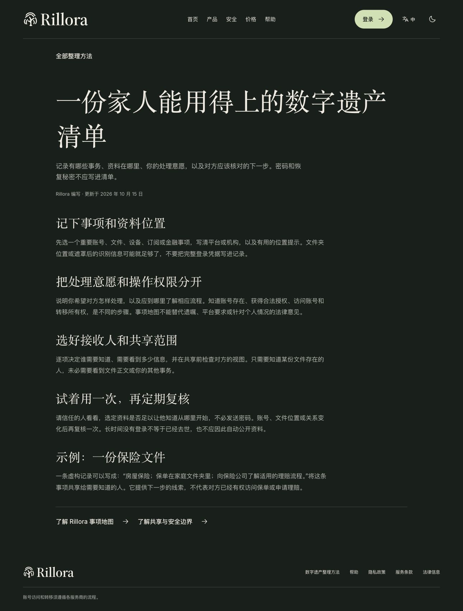

# October16 官网 GEO 发布与搜索平台验收

Status: PUBLIC WEBSITE LIVE / BOTH OWNERSHIPS AND SUBMISSIONS VERIFIED / INDEXING PENDING
Last updated: 2026-10-16 (Asia/Hong_Kong)

[完整合同](../../../docs/architecture/public-discovery-rollout-20261016.md)区分已发布网站、站长平台提交、实际抓取与尚未完成的索引／推荐。官网使用653093e62／[CI165](receipts/ci165.json)已通过源码，复用原54文件产物，没有重复构建或全量本地测试。

- [两阶段记录](receipts/rollout-events.json)：先上传assets／pages及DEVELOPMENT函数，确认原首页和LIVE不变；再发布完整源码模板。失败的原部署角色上传尝试及改用既有operator的过程保留。
- [第一阶段](receipts/stage-verified.json)：51实际S3对象匹配，原首页／LIVE函数字节不变。
- [最终实际读回](receipts/live-verification.json)：53公开HTTP对象、20语言页面和2根S3对象匹配；CSP／无Cookie／私有入口拒绝／旧指南与语言跳转保持。最终云端模板和LIVE函数一致。
- [浏览器](receipts/browser-verification.json)：真实英文文章到中文路径及完整中文正文；Rillora／CSP错误0，用户MetaMask扩展告警单独排除，未修改扩展。
- [Google DNS](receipts/search-console-dns.json)及[Bing DNS](receipts/bing-dns.json)：34→35→36，每次所有旧记录完整保留；各自两权威／两公共DNS均确认。
- [搜索平台实际结果](receipts/search-platform-progress.json)：两家所有权确认及各一次地图提交完成。Google即时提取成功但常规地图报告仍无法抓取／0已发现；Bing地图Processing，尚未证明收录。原始失败／Bing前端空白及重新加载恢复如实保存。
- [阅读链](receipts/reading.json)、[文档收尾](receipts/documentation-closeout.json)及[源码扫描](receipts/source-scan.json)分别记录：沿用完整阅读，32条原登记／0未知，不改扫描规则或豁免。

[新增archive43](snapshot.json)保存226路径／118对象，1,646,127密文字节；[本地完整认证](archive-verification.json)通过，[目录](catalog.json)定位精确原件。公共部署产物、HTTP／S3字节、裁去账号区域的结果图及失败／成功日志保留；凭据、登录URL、原始DNS管理对象、账号页和第三方缓存明确排除。旧archive1—42不重封、不重下。后续独立远端下载回执直接补交，不递归归档。

只更新既有RilloraPublicWeb栈和两条所有权DNS证明。App14、正式API／数据库、数据、价格／收费和FanPass保持，未发TestFlight。无GSC数据导入、DNS账号委托、广告、Clarity或新增跟踪。MCP的本机真实OAuth与公网托管闭环继续分别记账。

