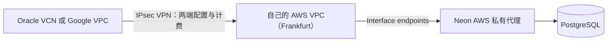

# Oracle／Google＋Neon：网络前提、真实计价与迁移取舍复核

Status: SOURCE AND ARITHMETIC REVIEW COMPLETE / NO COMPLETE PRODUCTION QUOTE / NO MIGRATION
Last updated: 2026-11-03 (Asia/Hong_Kong)

Owner要求重新仔细核对甲骨文＋Neon和Google＋Neon，避免CF比较中把组件起步价当整体降本结论的错误。本轮延续同一成本调查，保持原私网／权限／加密／恢复目标、真实数据、价格、FanPass和审核状态；没有开户、买套餐、建立VPN或迁移。Cloudflare询问仍按Owner要求暂存，Neon询问未发送。

## 结论与对旧建议的修正

后续Owner要求检查Vercel及比较误区。[方法纠正](vercel-cost-method-20261103.md)明确：本报告仅核价所列托管VPN路径，尚未完成最低成本合格架构的比较，不能据此认定其他平台整体更贵或迁移无价值。下表数值／来源与未验证范围保持；原生连接、按需任务及不同保护实现须先评估再定价，不重复叠加所有可选网络产品。

**不能再把Google＋Neon约11.51美元、Oracle＋Neon约24.96美元的旧组件小计作为Rillora生产迁移建议。** 它们使用较便宜的Neon Launch和已改造的按需运行假设，没有证明当前私有数据库边界能低成本保留。旧数字仍保留其历史和范围，但“先验Cloud Run＋Neon”的低成本优先判断由本轮取代。

Neon当前新项目只部署在AWS，Azure已停止新建；其官方私网方案是AWS PrivateLink，要求同AWS区域的接入客户端和Scale组织资格。没有查到可直接接入Google VPC或Oracle VCN的原生Neon私网产品。因此，换应用主机不会自动去掉AWS侧费用。Google／Oracle的网络文档支持跨云VPN，但这不是Neon对这条组合路径的端到端支持／可用性承诺。

**在所核对的托管VPN路线中，Oracle网络侧较便宜；两种组合均未证明能低于当前AWS收敛方案。** 这不等于任何Oracle或Google架构都有下表费用。自管加密隧道／受限代理可能更便宜，但增加主机、路由、证书与故障维护，需要独立验证；不能把它按0美元计入，也不能把托管VPN例子说成最低可能价。

## 同一比较口径

- 一个生产环境，730小时规划月，Neon Frankfurt `aws-eu-central-1`，应用也选择相近的Frankfurt区域。原AWS120.63资源费包含正式／预览两环境，37.63是减83赠金后的历史净账单，均不是这两组合的等价单环境报价。
- 保留数据库不公开、TLS证书验证、低权限角色／事务授权、独立密钥及删除／恢复日志权限、七天PITR。私网不是加密的替代品，VPN也不等于整个链路没有公网承载：IPsec的底层仍可走互联网，数据库可以保持无公网入口；是否符合完整既有保护仍要验。
- 起步数据库例子：0.25CU连续活跃、5GB月数据、5GB月保留WAL。这里只是明确的规划输入，不是生产逻辑容量实测；10万API请求用于后续规格比较，不从它推断固定注册人数或吞吐保证。
- 免费配额只有满足账户／区域／容量条件且尚有余额时才扣。试用金、Startup赠金不进长期基本盘。不会给Oracle单VM和Google多副本托管捏造相同SLA。
- **只对已选择、已核价的项目求小计，完整总价保持null。** 未确定的DNS、身份、入口、任务等费用不能填0；同时不强行复制CF模型的三个常驻单元。

## 先核对能否连接，而不是先加套餐价格

候选托管网络路径为：

这是一条需要验证的工程组合，并非已经部署。AWS一般性文档允许从VPN连接的外部网络访问interface endpoint；Neon指南仍写明AWS侧客户端前提，因此要确认其支持范围。项目还须设置并验证`block_public_connections`，不能只创建PrivateLink就声称公网已封闭。

DNS也不能漏：保留原Neon主机名、TLS验证与SNI，正确解析到私有端点。AWS文档提供区域端点DNS或Resolver转发等办法；不能擅自关闭证书验证、固定一次IP、把Neon原始连接地址当Google私有DNS自动可见，也不能未经选择就给所有方案硬加昂贵托管Resolver。

Google使用Direct VPC egress可避免旧Serverless VPC Access连接器的常驻VM费，但**它只接Google自己的VPC，不会免费把Neon接进来**；跨云VPN／网络费仍在。官方同时提示启动时可能出现较长的出站连接建立延迟，后续必须测试登录、支付通知和数据库冷启动，而非仅测health。

依据：[Neon区域](https://neon.com/docs/introduction/regions)、[Neon私网](https://neon.com/docs/guides/neon-private-networking)、[AWS端点跨网络与DNS](https://www.repost.aws/knowledge-center/vpc-interface-configure-dns)、[Google Direct VPC](https://docs.cloud.google.com/run/docs/configuring/vpc-direct-vpc)、[Oracle到AWS的官方VPN示例](https://docs.oracle.com/en-us/iaas/Content/Network/Tasks/vpn_to_aws.htm)。

## 当天核对的单价与容易漏算的条件

| 项目 | 已核对USD单价 | 核对方法与范围 |
| --- | ---: | --- |
| Neon Scale计算 | 0.222/CU小时 | 官方Neon文档工具；私网／IP Allow属Scale，Launch不能替代 |
| Neon数据／恢复历史 | 0.35/GB月、0.20/GB月 | 历史按WAL变化计量；付费默认1天须显式改7天 |
| AWS Frankfurt interface endpoint | 0.012/项/AZ小时 | 当天公开区域Price List，非美国默认价 |
| AWS Frankfurt普通Site-to-Site VPN | 0.05/连接小时 | 当天区域SKU，非Client VPN、5Gbps或Concentrator |
| AWS公网IPv4 | 0.005/地址小时 | VPN每条连接有两个隧道地址；按两个计入，不能漏掉 |
| Google Frankfurt Cloud VPN | 0.06/隧道小时 | 在官方页实际选择europe-west3后读回；默认Iowa显示0.05，不能照抄 |
| OCI Site-to-Site VPN | 无按隧道服务费 | Oracle侧免费，不抵扣对端AWS账单；出口与实际适用条款另核 |
| OCI A1 | 0.01/OCPU小时＋0.0015/GB内存小时 | 官方美元价目；没有以x86超线程单位换算Arm核心 |
| OCI Balanced启动盘 | 0.0255＋10×0.0017＝0.0425/GB月 | 官方美元表；50GB盘要另外2.125/月 |
| Cloud Run Frankfurt普通服务，实例计费 | CPU0.0000216/vCPU秒；内存0.0000024/GiB秒 | 实际选区读回，未使用承诺折扣 |
| Cloud Run Frankfurt服务，请求计费 | CPU0.0000336/vCPU秒；内存0.0000035/GiB秒 | 同一官方选区；请求量、活跃时长与并发另计 |

Google VPN正在使用的隧道公网地址不另收地址费；AWS VPN的公网地址则另计。这里选择AWS Virtual Private Gateway路径，没有凭空加入Transit Gateway费用；若以后选TGW，须再增加其attachment和数据处理费用。

下表Google单链路明确采用[Classic VPN静态路由](https://docs.cloud.google.com/network-connectivity/docs/vpn/how-to/creating-static-vpns)的一网关／一地址／一隧道示例，地址实际用于隧道；不是只配置一个接口的HA网关。若改成HA网关但留下未使用的外部地址，须按当时IP价另计，不能继续套用零额外Google地址费。AWS侧两个已分配隧道地址仍计费。

Google与AWS连接若要满足Google隧道层99.99%方案，官方配置是Google四条隧道＋AWS两条VPN连接，不是两条Google隧道。该高可用示例独立列出，不作为目前Single-AZ应用的必选；即使VPN满足其SLA，也不证明数据库／应用整体同SLA。

依据：[Neon价格](https://neon.com/docs/introduction/plans)、[Google VPN](https://cloud.google.com/vpn/pricing)、[Google AWS四隧道方案](https://docs.cloud.google.com/network-connectivity/docs/vpn/how-to/connect-ha-vpn-aws-peer-gateway)、[AWS VPN与IPv4计费](https://aws.amazon.com/vpn/pricing/)、[Oracle计算](https://www.oracle.com/cloud/compute/arm/)、[Oracle美元价目](https://www.oracle.com/cloud/price-list/)、[Oracle网络FAQ](https://www.oracle.com/cloud/networking/virtual-cloud-network/faq/)、[Cloud Run价格](https://cloud.google.com/run/pricing)。精确AWS SKU和公开文件版本见[价格回执](../../collaboration/verification/oci-google-neon-20261103/prices.json)。

## 托管连接费用：只给所列项目的小计

所有行沿用上述数据库例子：`182.5×0.222＋5×0.35＋5×0.20＝43.265`。Neon当前指南列8个Frankfurt接入服务，按一AZ计70.08；是否支持单项目只接一个尚未确认。一个AWS VPN连接为`730×(0.05＋2×0.005)＝43.80`。

| 明确选择的参考路径 | Neon计算／存储／历史 | 8个私网端点，一AZ | AWS VPN及其IPv4 | Google VPN | **仅数据库＋所列网络固定费** |
| --- | ---: | ---: | ---: | ---: | ---: |
| OCI官方单活动链路示例 | 43.27 | 70.08 | 43.80 | 0 | **157.15/月** |
| Google Classic单隧道成本示例，无HA承诺 | 43.27 | 70.08 | 43.80 | 43.80 | **200.95/月** |
| Google官方AWS四隧道HA对照 | 43.27 | 70.08 | 87.60 | 175.20 | **376.15/月** |

**这些不是完整月费、不是最低可行价、不是已购买或已证明保护等价的配置。** 单链路只是把相同低冗余路径的计价拆开，不能因此直接上线。这里还没加应用、流量、DNS、入口、密钥、日志和其他列于下节的费用。

若Neon以后明确支持当前单项目仅一个端点，三行分别减61.32；前两行变为95.83与139.63。这仍只是同路径的敏感性，不是已确定优惠。也没有把8项解释为永久不变的供应商限制。换成自管VPN／代理会改变连接费及运维责任，应另画完整路径、核对权限与可用性后重新计价，不能直接给所有Oracle或Google方案套用本表。

表格按美分展示，总额使用未舍入的十进制。VPN数据传输按两端实际方向计费，不因有VPN就全部免费；Neon和AWS端点还各有处理量费用。Google免费出口的地域／目的地限制不能用Iowa样例代替Frankfurt。

## 应用计算：分别列可获得的便宜模式与现有代码条件

**Oracle**：1OCPU／4GB内存＋50GB Balanced盘的标准价为13.805，即13.81/月；两个这种独立VM为27.61。它是计算／启动盘例子，不含数据库或完整运维，也未证明相同吞吐。具备相应资格、home region、剩余额度与实际容量时，这一小规格可以落在免费量内，但本轮没有创建或检查Owner的OCI租户，不能写成已经获赠。

Oracle当前Always Free文档为1500OCPU小时／9000GB内存小时、200GB块存储；美元价目脚注对paid tenancy另外写3000／18000。不得混用成任何新账户都能拿到4核24GB。官方写明缺货与闲置回收条件，不能通过伪造CPU负载规避。免费只能抵扣符合条件的Oracle资源，Neon和AWS侧仍计费。

**Google**：普通实例计费服务，1vCPU／0.5GiB连续730小时，未用免费额时59.9184；有全部适用免费额时54.6984，即54.70/月。两个同规格服务共享免费额后为114.62，不能给两项分别扣同一份免费额。Google免费额按Tier1美元价值抵扣，不能直接从Frankfurt用量扣相同秒数。此例不是Google最低计算价；Worker pools、独立Cloud Run instances和Compute Engine等运行形态要按用途另选，不能把两个普通服务当唯一安全实现。

10万次、200ms、有界且无常驻后台工作的HTTP负载，纯计算可能落在免费额内；它只说明按请求的潜力。当前[server.ts](../../apps/api/src/server.ts)有Apple30秒、Stripe5分钟、删除证明1分钟和内容清扫5分钟任务，另有独立身份删除循环。不能原样移到请求计费模式，再假定请求结束后的CPU能可靠执行任务，或Neon能长期休眠。改造必须保留领取、重试、幂等、死信、付款及时性与权限隔离；没有在本轮完成。

即使按需任务改好，Neon计算减少也不会让常驻的PrivateLink／VPN小时费随之停止。当前数据库0.25CU全天与100CU小时两种样例差18.315/月；对完整跨云网络账单的改善有限。

依据：[Oracle免费条件](https://docs.oracle.com/en-us/iaas/Content/FreeTier/freetier_topic-Always_Free_Resources.htm)、[Cloud Run计费](https://cloud.google.com/run/pricing)、[Direct VPC与连接器比较](https://docs.cloud.google.com/run/docs/configuring/connecting-vpc)、[工作器池手动伸缩](https://docs.cloud.google.com/run/docs/configuring/workerpools/manual-scaling)。

## 其余账单和安全工作逐项保留

| 项目 | 本轮处理，未给0元假定 |
| --- | --- |
| 正式域名／TLS／同源会话 | 保留原iOS地址和Web Cookie／CSRF契约。Cloud Run原生domain mapping不支持Frankfurt且官方不推荐其Preview作生产；负载均衡、既有入口或其他代理必须选定并计费，不自动沿用普通全球CF代理来声称认证处理地域不变。 |
| 数据库与应用两侧流量 | AWS VPN出口、Google出口、Neon双向私网量、AWS端点处理及可能的跨AZ费用逐项计；100GB／500GB等免费量不能跨计费产品随意套用。 |
| 私网DNS／维护／故障恢复 | 正确解析与SNI、端点／代理变化、DNS更新、隧道重连、MTU和失败重试需实际验证；不填一个未经选型的固定价，也不按0。 |
| KMS与短期身份 | 保留原非导出密钥和用途／主人约束。Google到AWS有官方短期OIDC联合方案，需绑定sub／aud／azp并分离各角色；这证明不一定需要常驻密钥代理，不证明本项目已接通。OCI实例身份直接换AWS短期凭据的等价路径本轮未确认，不能部署永久管理员密钥凑通。 |
| 外部恢复日志／独立身份删除 | 原独立验签、强制回执、撤销重放与删除凭据隔离继续；不合并进普通HTTP权限。运行形态可改，必须逐项验证后计费。 |
| 版本化对象／备份／七天恢复 | 保留全部VersionId删除及备份恢复后的状态核对。Neon七天历史单价只覆盖WAL量，不包含其他内容与恢复演练；不擅自复制真数据。 |
| Secret／日志／告警／镜像／调度 | 按实际记录、字节、保留期、操作和执行时间核算。当前应用与业务监控保留，只有可选诊断才讨论收敛；不因免费实例就把这些列删掉。 |
| 迁移期间与其他账单 | 原AWS直到明确切换并退役前仍收费；双运行、域名、Auth0、Resend、支付手续费、税、支持及自管工时单列，不把Startup金当持续省钱。 |

[AWS官方Google工作负载身份方案](https://aws.amazon.com/blogs/security/access-aws-using-a-google-cloud-platform-native-workload-identity/)和[Google域名限制](https://docs.cloud.google.com/run/docs/mapping-custom-domains)支持上述可实现路径／限制；不借此宣称新的身份或入口验收通过。

## 增长后的取舍

同样只看Neon Scale数据库：100CU小时／5GB数据／5GB历史为24.95；1CU全天／20GB数据／10GB历史为171.06；4CU全天／100GB数据／70GB历史为697.24，均未含网络。用户增长后的计算、WAL与网络量必须实测，不从用户数直接换算。Oracle便宜的固定算力和较大出口量可能更有价值，Google省运维与伸缩可能更有价值，但二者都不能消除Neon跨云接入这一共同项。

低用量时固定连接费占比高。若保留数据库私有且目标仍是低固定月费，应优先研究应用和数据库同云的组合、或在原AWS里把可选指标／预览／后台执行收敛；Neon不应因已选为候选就被视为不可替换的产品决定。原生同云数据库或自管PostgreSQL并未在本轮重新选型／报价，不承诺它们已经满足恢复与运维要求。

## 验证、边界与交接

本轮重新读取官方Neon工具文档、Oracle页面、Google选区后的实际美元表，以及AWS公开Frankfurt Price List；没有登录失效需要Owner处理，也没有账户权限扩展。Google默认区域与Frankfurt单价不同已留证，Oracle动态价格初次未加载后成功读回，没有将空白当0。

[计算脚本](../../collaboration/verification/oci-google-neon-20261103/model.py)和[结果](../../collaboration/verification/oci-google-neon-20261103/calculations.json)保留12项算术／边界校验；这不是新应用测试、性能基准、实际VPN连通或恢复验收。旧CF8次调用、MCP和真实购买结果沿用不重跑；没有子代理或云端CI。

下一次工程投入应先确定一个消除新增跨云固定网络费、同时能保留既有保护的拓扑，再做单一合成候选的容量／身份／恢复验收。当前不推荐直接迁移这两种Neon跨云组合，也不恢复已暂存的外发询问。
