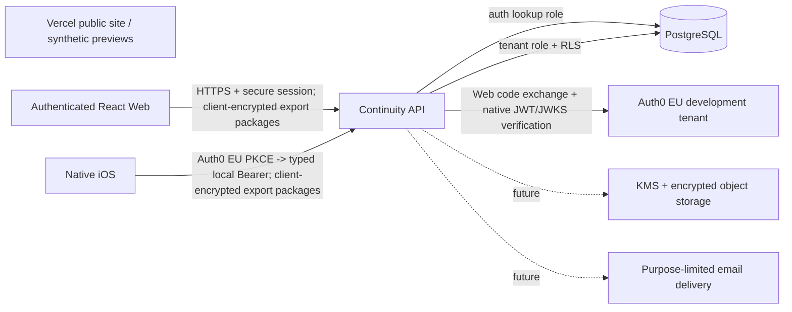

# Backend And Data Architecture

Role: canonical backend implementation and boundary contract  
Authority scope: API, PostgreSQL model, runtime security controls and production-open gates  
Superseded by: later reviewed backend decision recorded in `docs/decision-log.md`  
Do not use for: claiming production identity, real recipient delivery, production end-to-end encryption, legal validity or real release  
Status: CORE AND ACCOUNT-BOUND SHARING DEPLOYED TO SYNTHETIC STAGING; VERSIONED LEGAL GATE REQUIRED; STRIPE TEST LIFECYCLE VERIFIED; APPLE IAP DEPLOYMENT / REAL SANDBOX PURCHASE OPEN; ORDINARY ACCESS FREE; SALES / PRODUCTION ENTITLEMENTS / REAL SENSITIVE DATA CLOSED; EXPIRING VALIDATION ACCOUNTS ONLY  
Last updated: 2026-09-26 (Web price-v4 staged; production API unchanged)

## September26 Apple durable intake — current local increment

Production Apple now has isolated authenticated transaction and verified notification
routes, an owner-bound durable inbox, a leased bounded worker, immutable receipts
and current-state reconciliation through the shared ledger. Duplicate client restores
fetch fresh Apple state; known original-transaction owners cannot be overwritten.
Migration0080 adds lease/evidence/renewal metadata,0081 preserves separate observation
audits, and0082 keeps restores compatible with the older constraint-owned index name.
The production named-vault gate and optional aggregate queue alarms are prepared,
not configured or deployed.285API/40infrastructure tests and builds/typechecks pass.
Ordinary purchase quote/consent/native flow and actual Apple lifecycle remain open.
[Focused contract](production-apple-20260926.md),[checks](../output/qa/rillora-launch-goal-20260926/apple-intake-checks.json).

## September26 Apple ledger preparation — preceding local checkpoint

Production Apple status, channel-specific price bindings and immutable receipt storage now have local implementation. Stripe and Apple Sandbox reuse one subscription ledger; shared access and grants use one provider-grace clock. Migrations0076–0079 remain local-only, with266API tests/typecheck/build passing. No production Apple route, cloud rollout, native purchase or actual transaction is implied. See[the focused contract](production-apple-20260926.md).

## September26 Web price-v4 staging checkpoint

Owner selects WebUSD88.99/year: new immutable8899-cent price-v4, Family-v2,
annual-only new sales and separate Apple pricing. Staging now applies0068–0075
with exact checksums; API38/migration31 runs regularFargate1/1, HEALTHY/COMPLETED.
Current TEST Price and encrypted runtime configuration are read back. Historical
v3 remains8880/retired; no old receipt or customer data is rewritten. Recovery
journal remains opt-in without new staging DynamoDB/IAM/backfill access.

244API tests/typecheck/build pass. Production API task1/schema0070 remains at the
prior closed checkpoint; only its separate Web artifact is updated. The earlier
same-day source-only statements below describe their original checkpoint, not
current staging. [Price contract](pricing-88-99-20260926.md).

## September26 Apple verification foundation

Strict production Apple signature/ownership and explicit signed-price binding
modules now pass local typecheck/build and242API tests. They are isolated source
foundations, not configured ordinary transaction endpoints. Existing Sandbox/v1
mapping and production task1/schema0070 remain unchanged.
[Apple contract](production-apple-20260926.md).

## September26 production commerce source checkpoint

A separate production Stripe adapter, ordinary authenticated purchase/status/Portal
routes, versioned purchase consent and bounded verified-inbox retry are implemented.
Migrations0071–0073 are local-tested only; production task1/schema0070 and the test
runtime keep their prior deployments. The commerce checkpoint passed233API tests; source capability
is not configured live billing. [Focused contract](production-commerce-20260926.md).

## September17 current-session email proof — deployed checkpoint

Migration0060 grants the auth role only the identity columns needed for an exact session lookup and update of `verified_email_hash`. `POST /v1/sharing/email-verification` requires an authenticated cookie plus CSRF or typed native bearer, accepts an empty strict body, and is limited per authenticated session. Acceptance also refreshes missing proof through the same service. The provider request uses a distinct read-only credential and only `user_id,email,email_verified`; a foreign issuer/subject, malformed profile, outage, or session revoked during the request fails closed. Provider email verification is never written by this runtime.

Local API177, Web78, native151 passed/1 existing skip plus4 final shared-access tests, and infra19 pass. The final local mobile flow makes zero login/logout requests and checks a revoked continuously visible item in about15.4seconds. Real B had already accepted through the old flow; A revoked and B reload denied further reads. API30/migration23 and0060 are deployed and checksum-verified. A dedicated cloud fixture proves the same opaque token accepts after fresh Auth0 proof, with exactly one session and one legal receipt, then loses reads and rejects that same old capability after revocation.42 HTTP/asset checks pass; ordinary sales remain closed. [Active QA](../output/qa/rillora-real-invitation-20260917/README.md).

## September17 commerce/sharing runtime checkpoint

Migrations0048–0059 are applied with matching checksums. Reservations, paid-term snapshots, Free replacement, ordered reconciliation, invoice-bound refunds and validation receipts are implemented. Sharing enforcement is on; production entitlements are off. Test Checkout needs CSRF/enrollment, reuses pending orders, blocks duplicate subscriptions and supports cancellation. API167 is the retained application-test baseline. New-price Stripe sandbox payment/cancel/resume/refund and provider-backed cutoff now pass; Real B acceptance/revocation is now observed in the separate September17 continuation; its email-verification repair is deployed on API30/0060. [Current contract](commercial-completion-20260916.md).

## September17 provider delivery availability

Four signed refund/termination deliveries failed before reaching the application because the single Spot task was reclaimed; exact stopCode is SpotInterruption and Gateway reports No target endpoints found. The API now runs one verified healthy FARGATE task. Added operator read-only access to the exact Gateway diagnostics group; no secret read or verification relaxation. Recovered refund events apply, duplicate redelivery does not add ledger transitions, and test entitlements remain limited to explicit enrollment. [Provider/infra QA](../output/qa/rillora-stripe-acceptance-20260917/README.md).

## Account/matter extension — 2026-09-11

Migrations0041/0042 add bounded typed `details`, optional Notes and an explicit SQL field allowlist for Details-level recipients. All new matter writes and merged optimistic PATCHes enforce the selected category's minimum locator; the owner-approved maintenance write also checks the resulting required fields. Existing records remain readable and archive/revoke remain possible. Unknown/cross-category detail keys are rejected. Notes and typed details do not enter Name/Directions, public invitation previews, aggregate events or the minimum Start Here export.

The shared record mappers feed authenticated `/v1/overview`; native session exchange can include the same first-screen payload after successful identity/legal/session issuance. This reduces repeated authentication/transaction work without weakening RLS, CSRF, token verification or expiry. Current local suite:136 pass, typecheck/build pass. Existing0040 price migration is included in the completed synthetic staging update; no provider prices, entitlements or billing gate change. See [entry contract](account-matter-ux.md) and [QA](../output/qa/rillora-account-matter-ux-20260911/README.md). Staging update is complete: migration task15 exited0, API task20 is1/1 with rollout COMPLETED, CloudFormation UPDATE_COMPLETE, and30 HTTPS/asset checks pass. A separate read-only task confirms0040/0041/0042 cloud checksums exactly match source. Development auth stays off, Stripe test and existing maintenance preview on, Apple Sandbox and ordinary sales closed; the operations stack was not deployed.

## Earlier price/operations foundation — 2026-09-11

Migration0040 adds separate disabled USD prices68/year and7.99/month against
Family capability version2. Commerce catalog selects prices from the same ranked
plan version as capabilities, excludes retired/not-yet-effective/expired prices,
and returns one per period/currency with active terms preferred. Market-active and
sales-enabled checks both remain necessary for `purchasable`. The closed market
test, future/expired cases, old99/9.99 records and config/SQL agreement pass in the
130-test local suite. No provider receipt or entitlement was rewritten. Cloud was at0039 at that earlier checkpoint; the completed update above now includes0040–0042.

The operations handler is separate from the API and carries no database or
private-data credential. Future self-service jobs use a transactional outbox,
bounded worker leases and idempotent adapters per [the operating contract](solo-operations-and-portability.md).
That outbox, paid-cutoff snapshots and commercial allowances remain unimplemented;
this change does not claim the whole automated backend is active.

## Family maintenance — deployed preview, 2026-09-10

Migrations 0037–0039 add versioned review rounds/tasks/settings and owner-approved
provider/location change history. Owner tenant RLS and bounded recipient functions
separate viewing, suggesting and approval; the receiver never writes another
planner's Matter directly. Close/respond/approve ordering, source conflicts,
locked/expired capability and contributor-account deletion are tested. See
[the feature contract](family-maintenance.md). Current API tests are 129; migration
revision 14 exited 0, API revision 19 is 1/1, and 27 HTTPS/asset checks pass.
The server preview flag is on only in the existing synthetic staging; development
auth is off and ordinary paid entitlement mutation remains closed. This is not
production data, real notification or complete paid-cutoff sharing evidence.

## Current Outcome

Commerce Phase 1C is now deployed in Stripe test mode and remains structurally unable to sell. A restricted `rk_test_` and endpoint-specific `whsec_` are stored as two independent AWS Secrets Manager values; the staging operator can put／describe but not read them, while the ECS execution role receives exact-secret read only in the enabled task definition. Stripe endpoint `we_1U6ELcCxTlowhyiG6Foqyniw` is `livemode=false / enabled` at `https://app.staging.rillora.xyz/api/commerce/stripe/webhook` with fourteen Checkout／Subscription／Invoice payment／Refund／Dispute events. Migration `0026` adds a global minimal event inbox, Customer and provider-object links, reconciliation records and the independent `continuity_commerce` role. Authenticated test-only Checkout／Portal routes and the raw-body Webhook are live; ordinary commercial status still excludes test subscriptions, every market／sales／purchase-route policy is disabled, and this executor never mutates entitlement grants.

The restricted key currently grants `Checkout Sessions: Write`, `Customer Portal: Write` and `Subscriptions: Read`. Stripe's current `Core: Read` option was rejected because it inherits broad Balance／Customers and related reads; the earlier `GET /v1/account` runtime preflight was therefore removed. Account separation instead fails closed through the already verified control-plane Account ID plus account-specific Product／Price／Customer／Subscription references. The final monthly Checkout was later completed with a public test card: Stripe created test Customer／Subscription and delivered four signed payment／subscription events, all applied through authoritative reads while entitlement mutation stayed false and ordinary access stayed Free. Customer Portal creation and scheduled cancellation were also verified; revision `15` normalizes both Stripe's `cancel_at` and legacy `cancel_at_period_end` shapes.

A subsequent full test refund initially exposed an incomplete mapping: three signed refund events became durable `needs_mapping / subscription_reference_missing`. The deployed adapter now resolves Refund／Charge through Invoice Payments and Invoice parent Subscription, and converts only a successful full refund into authoritative `refunded`. Stripe phone verification added only `Charges and Refunds: Read` and `Invoices: Read`; unrelated resources remain `None`. Workbench resent `refund.updated`, which advanced to `applied` and produced `revoke / refunded / entitlementMutationApplied=false`; an immediate second resend produced no additional event or reconciliation. API task revision `16` is steady and the complete suite is `81 / 81`. No live object, real payment or ordinary entitlement change exists.

Revision `17` extends the same authoritative chain to Stripe Disputes using the current `du_` reference. Open／under-review／lost dispute statuses override the snapshot to `revoked`; won／prevented／warning-closed fall back to the current Subscription state. `Payment Disputes: Read` is the only added permission. A real sandbox fraudulent dispute moved the test Subscription to revoked, duplicate delivery was idempotent, and `winning_evidence` produced update／closed events that restored active. A separate subscription-linked invoice with Stripe's recurring-failure test card produced applied `invoice.payment_failed`, authoritative `past_due` and revoke; restoring a normal test PaymentMethod and paying the same invoice returned active. Every decision still records `entitlementMutationApplied=false`; ordinary access remains Free. Current complete API evidence is `82 / 82`.

StoreKit now spans the complete Xcode-local SK0 lifecycle plus a local App Store Sandbox SK1/SK2 execution path. Migration `0027` retains the local Xcode group; migrations `0028–0030` add the real Sandbox signal inbox/account binding and exact App Store Connect group/product bindings without enabling a public market, sale or ordinary entitlement. The official Apple server library verifies real Sandbox `x5c` transaction／renewal／notification JWS against three digest-pinned Apple roots. Authenticated device evidence and public Notifications V2 persist safely before any provider event. The App Store Server API adapter retrieves and verifies signed subscription status, and the durable executor writes provider event, subscription history and reconciliation before returning `finishAuthorized=true`; every reconciliation fixes `entitlement_mutation_applied=false`. The complete-set IAP credential exists locally: Chrome final `.p8`, Key ID and Issuer ID are ignored mode-`0600`; PKCS#8／OpenSSL parsing, local fingerprint, official Sandbox client construction and a bounded authenticated Apple `4040010 / TRANSACTION_ID_NOT_FOUND` probe pass. The first two no-private-file keys were revoked; Apple has one active key. The Apple-enabled AWS path is synthesized, not deployed. The earlier Pro Max `Products unavailable` result came from a stale Xcode-local StoreKit service routing to localhost; clean iOS 26.4／26.5 Simulators now load the real USA monthly／annual catalog. A fifth Debug-only purchase scheme submits signed transactions to local API 4182 and finishes only after durable authoritative acknowledgement. Current iOS evidence is `101 passed / 0 failed / 1 skipped`, API evidence `98 / 98`, and infrastructure `9 / 9`. After explicit Owner confirmation, three distinct Sandbox accounts across both clean runtimes all failed in Apple's post-AuthKit persistence step with `AMSErrorDomain 100 / Password reuse not available for account`; no transaction reached the API. Readback is zero StoreKit Sandbox inbox／event／subscription／reconciliation／mutation rows, and ordinary status remains Free. One automation-exposed replacement credential was immediately deleted and rotated; the retained third credential is Keychain-only. Completed purchase, signed device intake, App Review and ordinary entitlement remain unverified. The focused authority is `docs/storekit.md`.

Migrations `0031–0034` add the versioned registration legal gate. Web authentication starts only through `POST /auth/start`; native exchange carries the same exact legal proof. Legacy `GET /auth/login` returns `428 legal_acceptance_required`. The API accepts only the current Terms version, Privacy version, consent-copy version, normalized legal-bundle SHA-256 and literal affirmative Terms／Privacy-acknowledgement／electronic-record actions. Planner provisioning, append-only acceptance and typed Cookie／Bearer session issuance share one auth-role transaction. Every real session references a current acceptance, so old sessions or a changed bundle fail authentication rather than silently continuing.

`legal_acceptances` is append-only to the auth role. It records no document text, IP address, user-agent string or private-map content. Web and iOS evidence are de-duplicated per identity／version／bundle／surface. Account deletion sets planner and identity foreign keys to null while retaining a one-way identity-reference digest, document evidence and server time; this preserves bounded contract proof without retaining the plan. `GET /v1/legal/acceptance` returns the user's current bounded record. Public `/auth/legal-contract` exposes only versions, digest, legal URLs and the separate-recurring-charge boundary.

`apps/api` is a runnable TypeScript/Express 5 API backed by PostgreSQL 16-compatible migrations. It persists the planner, plan and its paired non-blocking first-use state, matters, people, role assignments, invitation state, official setup self-reports, simulations, non-operative disclosure-policy rehearsals, export preview/print metadata, client-encrypted Start Here ciphertext/key envelopes, local synthetic recipient rehearsals, sessions, append-only legal acceptances, append-only application audit events and privacy-filtered first-party product events.

The backend is deliberately production-shaped but not production-complete. Web can complete an Auth0 EU OIDC code exchange after password or Passkey authentication, map a verified identity to a planner and issue an opaque cookie session. Native iOS can present a short-lived Auth0 API access token to `POST /auth/native/session`; the API verifies its JWKS signature and exact issuer, audience, algorithm, subject, expiry, authorised party and scope before issuing an opaque native Bearer session. The provider token is discarded. Either authenticated credential kind can revoke the current Rillora session or every active Rillora session belonging to the same planner; this does not revoke Auth0 SSO sessions. The explicit non-production adapter remains available only behind its development guard. Start Here can return a minimum-disclosure plaintext guide without retaining its bytes, or accept a client-encrypted JSON package after full-snapshot, digest, key-point and exact-recipient-set validation. The server never receives its plaintext, unwrapped data key or offline recovery private key. A production-forbidden local flag exposes an isolated synthetic acceptance/device-key/decrypt rehearsal with no delivery or release. Planner-authenticated disclosure rehearsals separately model death, incapacity and missing paths, but their database and response contracts force every operative, identity, document, notification and release flag off. Commerce Phase 0 persists the provider-neutral ledger; Phase 1A adds synthetic signed adapters and pure reconciliation; Phase 1B adds Stripe Node SDK `22.5.0`, the exact test catalog and official verification／authoritative-read boundary; Phase 1C now adds the isolated durable HTTP executor described above. A verified notification remains only a signal, and only a fresh authoritative Subscription may produce a reconciliation decision. The system still does not send invitations, bind a real recipient identity, accept or verify documents, open a real claim or release data.

Owner-facing product trials no longer use a local API or database. Local PostgreSQL remains only as an isolated automated-test dependency. On 2026-08-12 the first synthetic-only AWS Frankfurt staging was deployed through the nonroot MFA operator and CDK roles: API Gateway HTTP API -> VPC Link/Cloud Map -> one ARM Fargate Spot task -> private encrypted Single-AZ RDS PostgreSQL. Secrets Manager holds separate generated administrator, runtime and confidential-Web credentials; the one-off migration/runtime-role task exited zero before the service was enabled. A private S3 bucket and CloudFront distribution now host the Web build and proxy only `/api/*` to the API, preserving Cookie/CSRF same-origin semantics. This environment is not approved for real sensitive data or production claims.



## Locked Backend Choices

- API: versioned JSON HTTP API under `/v1`.
- Runtime: TypeScript, Express 5 and Node.js.
- System of record: mutable PostgreSQL, not a blockchain.
- Tenant isolation: server-derived planner identity plus forced PostgreSQL Row Level Security on every planner-owned table.
- Identifiers: internal `bigint` primary keys and external UUID public identifiers.
- Concurrency: optimistic `version` fields on mutable records.
- Time: `timestamptz`, stored in UTC with planner time zone retained separately.
- Audit: runtime role can `SELECT` and `INSERT` audit events but cannot update or delete them.
- Secrets: no credential, private-key, seed-phrase or recovery-code columns; known secret-shaped request keys are rejected.
- Start Here encryption: AES-256-GCM content encryption on the client; RFC 9180 HPKE Base P-256/HKDF-SHA256/AES-256-GCM key wrapping per eligible recipient device and offline Owner recovery key; no server-held decryption key.
- Real claim/release: absent from the API, not hidden behind a feature flag.
- Production identity boundary: OIDC Authorization Code + PKCE; provider tokens are not retained after verified identity mapping.
- Platform roles: authenticated Web/API/data use AWS Frankfurt `eu-central-1`; Auth0 EU provides identity; Vercel is limited to public or synthetic-data surfaces. Exact resource shapes remain provisional until live infrastructure, contracts and regional evidence exist.

## Approved Deployment Direction

The Owner selected AWS rather than Vercel as the core Rillora platform. This is a role allocation, not deployment evidence:

- the first synthetic-only staging topology uses an API Gateway HTTP API, VPC Link and Cloud Map to reach one ECS Fargate task, avoiding a fixed Application Load Balancer and NAT Gateway while traffic is negligible;
- the staging task receives a public IPv4 address only for outbound Auth0/AWS HTTPS access; its security group accepts application ingress only from the VPC Link and permits outbound TCP 443 plus PostgreSQL to the isolated database. This is not approved for real sensitive data;
- PostgreSQL maps to RDS in `eu-central-1`; future encrypted objects map to private S3 plus regional KMS;
- Vercel must not host the production API, proxy authenticated planner responses or receive the application session cookie;
- a Vercel public site must use public/synthetic content and a separate analytics/privacy review;
- AWS CDK TypeScript is implemented under `infra/aws`; the default stack keeps `serviceDesiredCount=0` until the one-off migration/runtime-role task succeeds. Source and synthesis do not authorise bootstrap, account mutation or deployment;
- service sizes, subnet/egress design, CDN routing, high availability and the cost envelope must be recalculated before provisioning.

The initial planning bands are documented in `docs/identity-data-region.md`. They are not a purchase approval or evidence that the selected topology satisfies residency, recovery, uptime or independent-security requirements.

## Implemented API Surface

| Surface | Endpoint | Evidence boundary |
| --- | --- | --- |
| Health | `GET /health/live`, `GET /health/ready` | process/database readiness only |
| Session view | `GET /v1/session` | validates an existing opaque session or explicit dev adapter |
| OIDC callback | `GET /auth/callback` | Auth0 EU code exchange and opaque browser Cookie issuance after the versioned `POST /auth/start` transaction; legacy `GET /auth/login` fails with 428 |
| Legal contract／auth start | `GET /auth/legal-contract`, `POST /auth/start` | publishes current versions／digest and creates an OIDC transaction only after affirmative version-matched clickwrap; legacy `GET /auth/login` now fails with 428 |
| Native session exchange | `POST /auth/native/session` | verifies Auth0 EU RS256 API access token and issues a typed opaque local Bearer session |
| Legal acceptance evidence | `GET /v1/legal/acceptance` | returns only current versions, bundle digest, client surface and server timestamp for the authenticated planner; no document text or network fingerprint |
| Session revocation | `POST /v1/auth/logout`, `POST /v1/auth/logout-all` | revokes the current or all same-planner Rillora sessions; never claims Auth0 provider-session revocation |
| Plan | `GET/PATCH /v1/plan` | mutable plan metadata and paired `firstUseState / firstUseStep` with optimistic version; guide progress alone never changes readiness |
| Matters | `GET/POST /v1/matters`, `GET/PATCH/DELETE /v1/matters/:id` | archive is reversible metadata, not external deletion |
| Trusted contacts | `GET/POST/PATCH /v1/trusted-contacts` | records roles; does not send a real invitation; revoke/archive also revokes the matching role and any current invitation record |
| Role assignments | `GET/POST/PATCH/DELETE /v1/role-assignments` | planner-authored plan-wide or matter-scoped record policy with optimistic versions; recipient is matter-only, invitation-backed evidence is immutable, and no route grants authority, access or release |
| Official setup | `GET/PATCH /v1/official-setup-checks` | user self-report; does not change provider settings |
| Readiness | `GET /v1/readiness` | versioned product calculation; simulated confirmations are flagged |
| Simulation | `POST /v1/simulations` | always returns `simulationOnly`, sends nothing and releases nothing |
| Disclosure-policy rehearsal | `GET/POST /v1/disclosure-rehearsals`, `POST /v1/disclosure-rehearsals/:id/actions` | planner-only, versioned death/incapacity/missing rehearsal with event-specific states, exact role-field previews and literal action acknowledgement; all real identity, evidence, notification and release capabilities remain false |
| Start Here preview | `POST /v1/exports/start-here/preview` | 15-minute no-store JSON preview containing only the current safe output fields; revoked contacts are excluded, a SHA-256 full-snapshot commitment is stored, and no file is created |
| Start Here printable | `POST /v1/exports/start-here/printable` | requires the planner-owned preview, unchanged commitment and literal plaintext/non-revocation acknowledgements; returns minimum-disclosure UTF-8 text inline with no retained server file copy |
| Encrypted Start Here preparation | `POST /v1/exports/start-here/encrypted/prepare` | requires a fresh unchanged preview; creates a 15-minute pending package and returns the full-snapshot commitment plus at most 20 public keys for real accepted active recipient devices |
| Encrypted Start Here finalization | `POST /v1/exports/start-here/encrypted/:publicId/finalize` | accepts bounded ciphertext and recovery/recipient HPKE envelopes only after digest, P-256 point, unchanged-snapshot and exact-recipient-set validation; never accepts a private or plaintext key |
| Encrypted Start Here retrieval | `GET /v1/exports/start-here/encrypted/:publicId` | authenticated owner retrieval of the ciphertext JSON artifact and public/wrapped envelope material; contains no recovery private key and performs no delivery |
| Synthetic recipient rehearsal management | `GET/POST/DELETE /v1/recipient-rehearsals` | planner-only creation/list/revocation of a 30-minute simulation invitation and rehearsal; returns a one-time acceptance capability only at creation and never sends it |
| Synthetic rehearsal package | `POST /v1/recipient-rehearsals/:id/packages/prepare`, `POST /v1/recipient-rehearsals/:id/packages/:packageId/finalize` | planner-only, rehearsal-bound package path; requires unchanged preview, exact active synthetic device-key set and explicit no-delivery/no-release acknowledgement |
| Synthetic recipient acceptance | `POST /recipient-rehearsals/accept` | local-flag-only one-time capability exchange; only SHA-256 hashes are stored and the result is a separate short-lived rehearsal session, not planner authority |
| Synthetic recipient key lifecycle | `GET/POST/DELETE /recipient-rehearsals/device-keys` | local-flag-only public-key enrollment/list/revocation under `Rillora-Rehearsal`; private-key-shaped fields are recursively rejected |
| Synthetic recipient artifact | `GET /recipient-rehearsals/packages/:publicId` | returns only the matching ciphertext and active recipient envelope; excludes the Owner recovery envelope and fails after device revocation |
| Audit | `GET /v1/audit-events` | keyset-paginated, content-minimised events |
| Capability truth | `GET /v1/meta/capabilities` | explicitly reports disabled production capabilities |
| Commercial status | `GET /v1/commerce/status?serviceMarketCode=...` | returns the server-owned Free/Family plan-version/capability catalog, integer-minor-unit disabled price hypotheses, current subscription/entitlement view and literal safety boundaries; it never opens checkout |
| Purchase-route evaluation | `POST /v1/commerce/purchase-route` | re-evaluates service market, client surface, instantaneous iOS storefront, current active renewal provider and provider-product readiness; every current policy returns `none` and `billing_closed` or another fail-closed reason |
| Stripe test Checkout | `POST /v1/commerce/test/checkout` | authenticated and CSRF-protected; reserves the order／attempt transactionally, accepts only a server-owned billing period plus idempotency key, and returns a hosted test URL while every sales／route／entitlement boundary remains false |
| Stripe test Portal／status | `POST /v1/commerce/test/portal`, `GET /v1/commerce/test/status` | Portal requires an already reconciled server-owned Customer; status exposes only the planner's bounded test records and never opens ordinary billing |
| Stripe test Webhook | `POST /api/commerce/stripe/webhook` | exact raw body plus official signature verification; durable global inbox before acknowledgement; fresh authoritative Subscription required before test-only reconciliation; no entitlement mutation |

## Data And Trust Boundaries

### Tenant-owned tables

`planners`, `plans`, `matter_items`, `people`, `role_assignments`, `invitations`, `official_setup_checks`, `claim_simulations`, `disclosure_rehearsals`, `export_packages`, `recipient_rehearsals`, `recipient_device_keys`, `export_key_envelopes`, `audit_events`, `product_events`, `commerce_accounts`, `commerce_subscriptions`, `commerce_subscription_state_history`, `commerce_entitlement_grants`, `commerce_orders`, `commerce_payment_attempts`, `commerce_provider_events`, `commerce_settlements` and `commerce_refunds` carry planner ownership. Planner routes use the least-privilege `continuity_app` role and transaction-local planner ID; it cannot write the global provider inbox. Phase 1C adds non-inheriting `continuity_commerce`: it may reserve／update the exact test commerce records and global inbox needed by the executor, but cannot write entitlement grants. Cross-record foreign keys bind subscription price to plan version, entitlement to the same commerce account/subscription, and order/payment/settlement/refund provider-currency snapshots to one transaction lineage. A partial unique index permits at most one active renewal provider for a household plan. `disclosure_rehearsals` has forced RLS plus database checks that bind each life event to its own state prefix and require simulation-only records with every real-operation flag false. Role-policy mutations version the policy and stale older disclosure snapshots; matter/person lifecycle cascades revoke related roles and invitations in the same transaction. `product_events` has forced RLS and an exact event/property database constraint; the runtime role can insert but cannot read, update or delete it. Local public rehearsal routes use a separate `continuity_rehearsal` role plus one-way acceptance/session-token hashes and transaction-local rehearsal context; forced RLS limits that role to one rehearsal, its device keys and its package envelope. Ordinary recipient-device eligibility still requires a non-simulation accepted invitation, so synthetic keys cannot enter the standard export path.

### Authentication table

`identity_accounts`, `auth_transactions`, `auth_sessions` and minimized `legal_acceptances` are outside planner RLS because they establish planner identity and legal authority to issue a session before a tenant context exists. Identity mappings store only provider `issuer + subject`, not provider access/refresh tokens; verified display name/locale may initialise the separate planner profile. Login transactions are short-lived, one-time and all-or-none legal-bound; session and CSRF values are stored only as SHA-256 digests. Every real session links to a current acceptance; the auth query independently matches Terms, Privacy and bundle digest. Legal evidence is append-only and cannot update／delete through `continuity_auth`; planner deletion removes the map and nulls direct identity links while retaining a one-way reference digest. Migration `0009_native_bearer_sessions.sql` gives every session an enforced `browser_cookie` or `native_bearer` credential kind. Authentication rejects cross-use: a Cookie session cannot be replayed as Bearer to bypass CSRF, and a native Bearer cannot establish browser Cookie authority. Current-session revocation binds the session public ID; bulk revocation binds the server-derived planner ID and never accepts a target planner from the client. The auth database role receives only the exact columns, function and update operations required to complete login, legal acceptance, validation or revocation.

### Contact delivery and attachments

The older schema reserves encrypted delivery-locator/object columns as ciphertext plus key version pairs; the current API does not write those columns or accept document uploads. The new direct-sharing API accepts a target email transiently, stores only its exact-match digest and masked label, and uses verified identity proof for acceptance. That digest is still personal data. Ordinary text Matter records and their permission projections are processed by the API and are not end-to-end encrypted. Start Here is a separate client-encrypted export record stored inline in PostgreSQL; it does not prove production attachment storage/KMS. See [trusted-sharing.md](trusted-sharing.md).

## Implemented Security Controls

- strict Zod request schemas and rejection of unknown fields;
- parameterised SQL only; dynamic identifiers are closed code-owned allowlists;
- `64kb` JSON body limit, bounded connection pool and server timeouts;
- Helmet headers, no Express fingerprint header and explicit CORS allowlist;
- global abuse limit, custom 404/error response and no production stack leakage;
- request IDs and structured logs with cookie, auth, CSRF and development identity redaction;
- `HttpOnly`, `Secure`-in-production, `SameSite=Lax` opaque session cookie contract;
- CSRF digest verification for cookie-authenticated state changes;
- exact credential-kind enforcement for browser Cookie and native Bearer sessions;
- remote-JWKS verification of native Auth0 tokens with a fixed EU issuer, API audience, RS256, native `azp` and `session:create` scope;
- production startup refusal when development authentication is enabled;
- production startup refusal when the synthetic recipient rehearsal surface is enabled;
- all-or-none OIDC configuration, HTTPS/redirect-origin checks in production, state/nonce/PKCE verification and relative same-origin return paths;
- 30-minute idle timeout, bounded absolute session lifetime and a maximum of 10 active sessions per planner;
- same-planner bulk local-session revocation with cross-planner regression coverage and explicit separation from Auth0 provider sessions;
- indexed tenant, foreign-key, status, review and keyset-pagination paths;
- full Start Here snapshot commitments, constant-time freshness comparison, exact accepted-recipient device-key binding, canonical base64url, valid P-256 point, fixed cryptographic-size and ciphertext-digest validation;
- database constraints require the encrypted package/envelope shape, one recovery envelope per package and at most one envelope per recipient device; least-privilege runtime grants cannot insert recipient private keys because no such column exists;
- recursive rejection of secret-shaped request fields, one-time hashed rehearsal acceptance capabilities, separate hashed rehearsal sessions, no capability in URLs, no Cookie/planner credential use on public rehearsal calls, and a unique active public key per simulation invitation;
- rehearsal/package same-planner foreign keys and standard-route exclusion of simulation invitations or rehearsal-linked packages;
- event-prefixed disclosure-rehearsal state checks, fixed non-operative database flags, strict role-field allowlists and version-bound action transitions;
- active role uniqueness, matter-only recipients, invitation-backed edit locks, explicit revocation, person/matter lifecycle cascades and stale disclosure-snapshot enforcement;
- transaction-coupled product events with exact server/database allowlists, coarse `web|ios|unknown` provenance, forced RLS, insert-only runtime privilege and a 90-day deletion-deadline marker;
- migration checksums and a transaction-scoped advisory migration lock;
- separate administrator-only migration and non-inheriting runtime database logins; the runtime login can assume only the three code-owned least-privilege roles, and its generated password can be rotated idempotently;
- production database startup requires `verify-full` TLS with the AWS RDS CA bundle; the container downloads that official bundle during build and verifies its pinned SHA-256 before installing it;
- production containers bind on an explicit host, run as the unprivileged Node image user and expose process/database health separately;
- development/test fixtures separated from production by a hard environment guard.
- commerce prices stored as integer minor units plus an explicit decimal exponent, with no client floating-point catalog authority;
- disabled-by-default market/storefront/purchase-route policies, two explicitly `test_only` Stripe catalog bindings and no runtime commerce write grant;
- server-authoritative commercial boundary flags that forbid client purchase state, provider callback alone or billing state from directly granting access or triggering claim/disclosure;
- effective-subscription and entitlement resolution is scoped to the requested service market, de-duplicates each capability and accepts a subscription-sourced grant only while its linked same-account subscription remains in an access-bearing state; Global and Mainland cannot read one another's paid access, and an expired or revoked subscription cannot survive merely because a stale grant row remains;
- test-only Stripe-style fixtures and the official Stripe SDK verifier are capped at 256 KB and bound to the unmodified body; the official adapter hard-binds account-specific Customer／Product／Price／Subscription references and metadata, requires Checkout idempotency, rejects live mode and never treats a callback or success URL as entitlement evidence;
- synthetic Apple fixtures remain isolated, while the App Store Sandbox path separately verifies real Apple `x5c` chains with the official server library, digest-pinned roots and exact bundle／environment／group／product／planner-token／storefront binding; no JWS or callback grants access;
- provider reconciliation is idempotent and delivery-order independent, requires an authoritative snapshot observed at or after the signal, revokes on refunded／revoked／expired／past-due state, holds access on stale evidence or competing access-bearing subscriptions, and rejects equally recent but mutually inconsistent snapshots instead of choosing by input order;
- one-active-renewal-provider uniqueness and cross-record plan/price/account/provider/currency lineage constraints.

## Local Verification

Current verified commands in `apps/api`:

```text
npm run typecheck
npm run build
npm test
npm audit --omit=dev --audit-level=high
```

The integration suite uses the dedicated `continuity_test` database and refuses to truncate any other database. The pre-hardening Commerce Phase 1B checkpoint was `77 / 77`: the prior domain/auth/encryption/first-use and Phase 1A coverage plus official Stripe raw-body signature verification, live/tamper/oversize rejection, exact Account mismatch refusal before provider writes, server-selected Price and metadata, stable Checkout idempotency, fixed Portal return／Customer binding, authoritative Subscription mapping, no-trial and conservative status behavior, complete test-only configuration, live-key refusal, same-origin returns and the two exact database catalog bindings. On 2026-08-20 a fresh rerun exposed that two official-SDK signature tests depended on the wall clock after their fixed header timestamp crossed Stripe's tolerance; the fixture now supplies its frozen receive time explicitly to the official verifier, preserving recency validation without becoming date-dependent. That checkpoint returned to `77 / 77`; the current post-preflight total is recorded below. Migrations `0022–0025` add the commerce tables, currency precision, cross-record lineage and non-live Stripe Account／Product／Price mapping without granting runtime commerce writes or enabling a route. API typecheck, build, full tests and both production-only and complete dependency audits pass. Migration `0021_nonblocking_first_use.sql` adds database-checked `available / guide_in_progress / guide_paused / completed` state-step pairs; integration coverage verifies a new account starts at `available / 0`, inconsistent pairs fail closed, and an explicit first Matter save moves the plan to `completed / 2` without awarding readiness for guide answers. The latest tests also cover all three disclosure-rehearsal state machines, exact role-field projections, planner-authored role create/edit/revoke/recreate, invitation-backed immutability, active uniqueness, person/matter cascades, snapshot invalidation, RLS/least privilege and the database hard-false boundary. Product-event coverage proves exact property sets, invalid-source degradation, insert-only runtime access, the 90-day marker and database rejection of an extra content field.

The AWS CDK project passes build-before-test, TypeScript validation, `8 / 8` infrastructure assertions and both enabled／disabled CloudFormation synthesis in `eu-central-1`. Assertions cover the two-phase service start, encrypted/private/deletion-protected Single-AZ RDS, separate write-only-operator Stripe secrets, conditional ECS injection, Fargate Spot, absence of NAT, a private encrypted Web bucket and CloudFront behavior that proxies only `/api/*`. The live stack is `UPDATE_COMPLETE`; API task revision `14` is steady at `1 / 1`, migration task definition revision `9` is current, `/health/live` and six consecutive `/health/ready` probes returned 200, and the raw Webhook rejects an invalid signature with a sanitized 400. `https://app.staging.rillora.xyz` still uses the preserved Web asset, single CloudFront alias, ACM `EC_prime256v1` certificate and TLS 1.2_2021. API production／complete audits and infrastructure production／complete audits report zero vulnerabilities after upgrading to `aws-cdk-lib 2.266.0` and `aws-cdk 2.1138.0`. Fargate Spot interruption, Single-AZ recovery and one-day backup retention remain explicit staging limits.

The native iOS foundation has 71 passing unit tests on iPhone 17e Simulator with iOS 26.5. The first-use tests cover persisted guide progress, pause/resume, synthetic preview and prefilled-but-unsaved Matter drafts. A pre-existing ciphertext-tamper test was also made deterministic by mutating a decoded byte instead of replacing the final Base64URL character, whose unused padding bits could leave the decoded ciphertext unchanged; the focused test then passed five consecutive iterations before the full suite. On that simulator, disposable `.invalid` identities previously completed Auth0.swift system-browser Code + PKCE both before and after the Debug issuer moved to `login.rillora.xyz`; the custom-domain run exchanged its provider access token for a local Bearer session, loaded the shared plan, survived an app-process restart through a Keychain-held Rillora session and then signed out. The API identity row recorded the exact custom issuer, and Auth0 logs corroborated authentication, code exchange and logout. Web separately completed password login, virtual-WebAuthn Passkey enrollment, two `phr` Passkey logins and live bulk revocation of all three resulting Rillora sessions. Auth0 tenant logs corroborated the Passkey enrollment and phishing-resistant authentication method. The recovery endpoint returned the same success response for existing and absent `.invalid` addresses, but the existing-user email intentionally failed delivery because the test domain has no MX/A record. Every synthetic Auth0 user, temporary secret/passkey and resulting local synthetic planner row was deleted after its validation; the simulator Passwords item accidentally created during the final native run was moved to Recently Deleted without permanent purge.

Start Here first completed plaintext preview/generation and native share-sheet presentation without saving or sending. The prior real local browser recovery-only flow encrypted the safe snapshot, locally decrypted it with a newly generated offline recovery key, finalized ciphertext with zero eligible recipient keys and exposed separate explicit download actions; neither file was downloaded. The synthetic recipient contract adds Web crypto 4/4; the expanded API client passes 13/13, first-use state tests pass 3/3, product-truth 3/3 and Sites 4/4 also pass, and the Web production build passes. Browser QA separately exercised public entry, Account gating, all three first-use paths, pause/resume, a synthetic example that remained absent from `matters`, explicit first-Matter save and unchanged `0/5` readiness before that save. The full API integration flow creates and consumes a one-time capability, enrolls only a public key, finalizes a rehearsal-bound envelope, decrypts recipient-side and loses future access after revocation. Web manual QA also covers role batch review, create/edit/revoke, assigned-recipient disclosure, stale warning, fresh snapshot and unsaved-Matter protection. No manually driven iOS role-editor/rehearsal run is claimed. Exact prior encrypted package `2e58712c-0477-4234-ab01-f318620fc8db`, source preview `f56406b9-85c0-4b5e-b9ce-3183a540d577`, three audits, two exports and the recovery envelope were permanently deleted after validation; exact-match checks returned zero. This is local protocol, policy-projection, first-party event-contract and client-encryption evidence, not real recipient identity/enrollment/delivery, proof verification, production analytics/deletion, production end-to-end encryption, external recovery-file handling, real-email recovery, native iOS Passkey, production mobile configuration, physical-device or TestFlight proof.

The native-only OIDC configuration regression added after the 40-test baseline first brought the suite to 41/41. Cloud runtime, proxy parsing, CloudFront aliases and non-error browser session detection now bring the complete API suite to 55/55; typecheck, build and production dependency audit pass. The Web API-client is 14/14 and the other 16 focused Web tests pass.

Current provider result: Stripe Phase 1C remains `82 / 82` at its deployed checkpoint. The complete local API suite is `103 / 103` after StoreKit official JWS intake, App Store Server API signed-status normalization, durable no-entitlement reconciliation, Sandbox catalog binding and versioned legal-consent enforcement. API typecheck, production build and dependency audits pass. The Apple long-term credential is locally complete and accepted by a bounded Sandbox Server API probe; clean iOS 26.4／26.5 catalogs load both real products. Simulator Sandbox authentication is externally blocked before transaction creation by Apple's repeatable `AMSErrorDomain 100` account-persistence failure. Apple-enabled stack deployment and the real Sandbox purchase／notification／restore lifecycle remain open, so these results are not a deployed Apple commerce or entitlement claim. The earlier `77 / 77`, `78 / 78`, `80 / 80`, `81 / 81`, `82 / 82`, `93 / 93` and `98 / 98` sentences remain exact historical checkpoints.

## Production-Open Gates

Before any real user data enters the system:

1. complete the remaining real-email recovery/link-consumption, Guardian/backup-factor, recovery notification and post-recovery freeze tests; add Auth0 provider-session revocation only under a separately approved plan/capability, and validate native iOS Passkey on a separate test Apple identity plus reviewed domain/associated-domain setup;
2. before real sensitive data, replace the current synthetic-only Single-AZ/Fargate Spot posture with reviewed recovery and egress controls, add a budget notification recipient, complete regional evidence and an independent deployment/security review; AWS Budgets is delayed monitoring and does not guarantee an automatic stop at the ceiling;
3. complete DPIA, retention, deletion, backup and incident-response design;
4. add KMS-backed envelope encryption only for fields whose product purpose justifies storage;
5. move Auth0/session settings from local Debug callbacks to reviewed Release configuration, then complete the remaining native P0 truth gaps: real invitation delivery/identity-bound acceptance, durable recipient device-key lifecycle and recipient portal; before production analytics, add consent/notice review, retention cleanup, aggregation/export rules and operator access controls;
6. add deployment TLS, edge limits, CSP for the Web shell, secret management and independent security review;
7. keep real claims and release closed until the full trust-and-safety gate is independently met.

Production identity issuance, real email delivery, identity-bound recipient enrollment/delivery, encrypted attachments, production encrypted storage, real claims and release are not implied by the current passing tests.

### 2026-08-11 native-only real-auth launch

The configuration loader now treats the native issuer/client/audience tuple independently from the confidential Web OIDC tuple. This lets the local API verify iOS access tokens without receiving a Web client secret it does not need. Production still refuses to start without complete Web identity issuance configuration. The focused configuration suite passes 8/8, followed by API typecheck and build. A local API started on `127.0.0.1:4180` with `ALLOW_DEV_AUTH=false`, the `login.rillora.xyz` issuer, the native client and `urn:rillora:api`; both an unauthenticated session request and one carrying a spoofed development identity header returned 401. The native Debug app then rebuilt without a planner override and reached Auth0 Universal Login. This is pre-registration path evidence only; no Owner credential, mailbox verification, account, local identity row or Bearer session had been observed at the time of recording.

## Account-bound invitations and recipient projections — 2026-09-10

Migrations `0035`/`0036` add sharing connections, explicit per-matter grants,
per-invitation HttpOnly handoffs and a verified-email digest on local sessions.
Invites use 32 random bytes, hashed storage, seven-day pending expiry, atomic
account binding and optimistic owner mutations. Web/Native identity now request
email; only boolean verified provider claims (with matching UserInfo subject for
native tokens) become acceptance proof. Email is not used as an account merge key.

Authenticated `/v1/sharing/*` routes manage connections, accept and list shared
items. Public `/sharing/invitations/*` and `/api/sharing/invitations/*` expose only
bounded invitation metadata from a valid capability/handoff. Planner RLS remains
unchanged. A non-login function-owner role exposes field-filtered recipient data;
runtime roles have no membership in that role. Never-disclose/archive removes
grants and invalidates connection versions, preventing silent re-sharing later.

Local API tests are **115 passing** including ten directed-sharing cases. On
September 10 the existing synthetic staging applied migrations through `0036`;
the exact migration image exited 0 and confirmed the runtime role. API task
revision 18 is running, CloudFormation is UPDATE_COMPLETE and all 18 HTTPS/asset
checks pass. Existing OIDC parameters, Stripe test enablement and disabled Apple
IAP are preserved. No recipient identity or external delivery is inferred from
deployment or the local synthetic acceptance tests.
Full schema/API/UX contract: [trusted-sharing.md](trusted-sharing.md).
