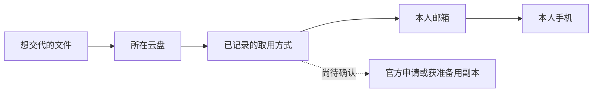

# 差异化付费候选：接手路径检查

Status: PROPOSED / NOT IMPLEMENTED / NOT AN APPROVED PAID ENTITLEMENT
Last updated: 2026-10-20 (Asia/Shanghai)
Authority scope: 本轮竞品研究后的具体产品候选；不改变现有权限、套餐或当前审核。

## 用户购买的结果

**提前发现家人接手时可能卡住的地方，并知道现在应该补齐什么。**

用户已有一张事项地图，却可能仍把唯一取用方式留在自己掌握的手机、邮箱、设备或另一个打不开的资料位置里。拟议功能检查这些具体关系，在资料变动后重算影响。先做本人可见的规划检查，不收集真实密码、不登录第三方账户、不通知真实事件或执行内容放行。

## 一个具体例子（虚构，不是真实测试结果）

用户记录：保单文件在云盘；目前记录的取用方式依赖本人邮箱；邮箱的唯一已记录验证设备是本人手机。选择“本人不能协助，手机也不可用”的假设后，系统显示：

> 你为这份文件记录的取用路径依赖本人手机，尚未记录另一条符合平台规则的路径。

展示依据、哪些记录过旧，以及可由本人准备的替代方向，如获准取用的备用副本或该平台官方继承／申请流程。不能把“没有记录备用路径”写成“已证实永远无法取得”，也不能指导亲友冒充本人或绕过平台控制。

日后本人修改邮箱、设备或联系人记录，检查指出哪些依赖此前信息的安排需要复核。只对实际相关的路径提示，不为了制造活跃度发全量提醒。

## 完整机制须包含什么

1. **具体关系**：事项、资料位置、平台取用方式、所需材料／条件、相关设备与人员之间的显式依赖；不只统计填了几个字段。
2. **按情景与接收人分析**：例如某设备不可用、主要协助人不可用，或者仅考虑已记录的正式身后申请路线。情景是本人主动选择的假设，不改变任何生命事件状态。
3. **可解释的断点**：没有记录起点、没有记录替代路径、路径互相循环、所选方式不覆盖目标资料、依据已过期或条件尚未确认。
4. **具体补齐顺序**：告诉本人先检查哪个记录／官方条件、再补哪个依赖；已记录的有效替代路径应阻止不必要的警告。
5. **变更影响**：资料、联系人或经复核的平台规则变化，使受影响的结果失效并指出范围；旧“完整”结果不自动沿用。

只有这套具体能力被实现并验证，才适合当差异化卖点。单独画关系图、增加百分比、生成通用AI建议或播放一次模拟解锁，都已有类似做法或不能证明实用价值。

## 与现有Rillora的关系

已有事项、联系人、官方指南、字段级共享预览、共同复核和新告知可以提供入口与基础数据。新图关系、分析规则、证据等级、受影响范围计算和结果生命周期都尚未实现。

本项目旧角色披露演练是内部安全QA工具，不能换名后重新塞回消费者流程或作为付费卖点。新检查须指出当前记录中的具体依赖问题，并允许本人直接修正；没有有用结果就不推进。

新告知表保持纯元数据，不塞入Matter grant或解密材料。新的本人规划关系应有独立模型与权限。未来接收人继续只知道存在安排，不能从检查结果获得标题、数量、关系图、评分、其他联系人或任何衍生摘要。MCP／AI访问也不因购买Family自动扩大。

## 第一版可验证范围

先限定用户主动选择的5个关键事项（原型范围，不是已批准商业配额），复用原有联系人／位置记录，补最少的依赖选项。默认只输出具体待办，关系图按需展开；保持现有导航，不新增强制长问卷或多级确认。

引擎优先采用确定性规则，明确依赖的“全部需要”和“任一可用”语义，并允许多个合法替代路线。仅画箭头不足以判断可行性。规则和来源要带版本、地区／产品适用范围及复核日期；输入未知、规则过期或平台条件无法确认时，输出待核实，不能自动给通过结论。

候选状态：已记录的路径完整（仅模型结论）、存在记录缺口、关键依据待核实、结果已过时。本人勾选／回报、官方文档说明及实际核验是不同证据。第一版不声称已测试第三方登录或继承成功，不提供单一“100%准备好”保证。

Apple规则可举例说明边界：遗产联系人不包含Keychain密码／passkeys等资料；Google不活跃管理按其自身条件分享数据。Rillora应引用[Apple](https://support.apple.com/en-us/102631)和[Google](https://support.google.com/accounts/answer/3036546?hl=en)当期规则，而不是推断一个平台授权能覆盖所有账户。这是产品规则参考，不是针对用户个案的法律判断。

第一版无需HealthKit、Apple死亡判定或外部账号写权限。它只检查记录的安排；真正的死亡核验、后续密钥与内容交付仍走独立产品和安全流程。

## 拟议免费／付费边界

- Free保留地图、现有基础缺项提示、原生官方指南、基础导出、权限保护与撤销；现有安全缺陷绝不能变成付费才修复。
- Family候选增加跨事项／逐人／多情景依赖分析、结果历史、相关变更影响和有界复核提示。不单独新增第三档，也不在本轮改价格。
- 既有用户资料与已生成结果保持可读取／导出；到期可停止新高级分析，但过期结果需标记，保护性撤销和基础编辑不被锁住。
- 前一轮免费1／Family5告知分层、两位规划者权益仍是未批准的独立候选。不得把本提案默认为已经接入收费或改变5位接收人的定义。

## 为何可能形成竞争力

[竞品研究](competitor-paid-research-20261020.md)已找到关联项目、免费评分、解锁模拟和人工依赖咨询。候选差异是把具体跨平台关系、情景计算、权限边界、规则来源和持续变化合成一个普通用户可用的流程。不是宣称依赖图或继承概念本身原创。

可积累的能力包括：经复核的平台条件库、解释清楚的依赖模型、覆盖例外与误报的测试案例、双语操作表达、用户主动核验留下的记录。单个界面或AI提示词很容易复制；这些需要持续维护，也尚未形成已有壁垒。不得靠阻止导出或把隐私资料用于广告来制造黏性。

## 成本、风险与验证门

元数据关系和确定性计算可以控制模型调用与存储需求，但尚无新增云账单／人力成本测量。实际成本重心可能是规则复核、错误提示处理和用户补充关系的时间，不是图形渲染。第一版不承诺无限媒体、人工遗产代办或全世界平台全覆盖。

先用合成案例验证设计，再进行另行安排的用户观察；本轮没有运行以下测试：

| 情景 | 必须得到的结果 |
| --- | --- |
| 所有已记录路径只依赖本人不可用设备 | 明确指出记录缺口，不能写成现实中无解 |
| 另有完整且适用的合法路线 | 不误报整个事项无法接手 |
| A的取用说明在B，B唯一说明又在A | 报告循环和缺少外部起点 |
| Rillora自身登录／导出也依赖不可用邮箱 | 将自身纳入依赖，指向既有免费离线资料准备 |
| 平台流程有国家、资料类别或证明条件 | 条件未确定时保持待核实，不给法律承诺 |
| 联系人撤销／事项变更后查看旧报告 | 旧结果失效，按当前权限重读 |
| 仅收到未来告知的亲友读取报告 | 拒绝，不泄露数量或衍生摘要 |
| 购买／取消Family | 不产生披露授权、不删除原始资料 |

接着用5–10次定性观察核对：是否发现用户原先不知道且复核成立的问题、是否完成至少一个有意义的补齐、录入是否过重、是否比现有清单多提供价值。该样本不证明转化率；在功能可交付后，才用实际付款和后续变化时的使用结果检验年费价值。若主要输出只是重复“多备份／加联系人”，应缩减或放弃这个付费方向。

本文件是可审阅候选，不是新功能完成报告。没有部署、发信、收费、第三方账号操作或当前审核修改。
